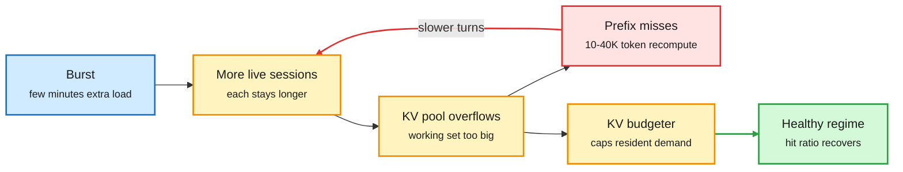

# Bursts That Outlast Themselves (2611.13412)

## TL;DR

Agent sessions are closed loops whose context grows every turn. Serving them cheaply depends on prefix caching: a cache hit costs an incremental prefill of about a thousand tokens, a miss recomputes a 10-40K-token context. Wen Huang and Jack Liu show this makes prefix-cached agent serving **metastable**. On an identical base workload, a few minutes of extra arrivals left a vLLM server in a degraded regime (about a **10% hit ratio, half the throughput, and a backlog that kept growing for the remaining 70 minutes**) while its no-burst twin stayed healthy, in 9 of 12 paired runs and never the reverse. The regime appears at loads the cache-warm server handles fine, vanishes without prefix caching, and reproduces with Qwen3-32B on SWE-bench agent traces and on SGLang (which tolerates larger triggers). Recovery is the hard part: throttling new admissions recovered 1 of 7 collapsed runs, a CPU offload tier only delayed collapse, but **suspending admitted sessions against a capacity limit recovered all of them within minutes**, and a budgeter that bounds the resident KV demand of active sessions prevented the failure in every run, with no per-workload tuning.

Slow service fills the cache, a full cache slows service

The loop that keeps the server degraded long after the burst has passed.

Blue is the trigger, amber is cache state and the fix, red is the costly miss loop, green is recovery.

## Key points

- **Mechanism.** Slower service keeps more sessions in the system. Their combined working set outgrows the KV pool, so every turn becomes a recomputation, which slows service further. A first-order workload-balance condition, calibrated independently, brackets when the regime can drain on its own.
- **It is caused by the cache.** Without prefix caching the server is slower on average but never enters the trap. The optimization that makes agent serving affordable is the one that makes it fragile.
- **Admission control is the wrong lever.** Throttling new arrivals does not shrink the resident working set of sessions already admitted. Suspending some admitted sessions does.
- **The fix is a KV budget per active session set,** not a rate limit: bound total resident KV demand to the pool size.

## Relation to prior wiki pages

- **Directly complements Evolving Infra (11-13)**, which let the agent's own context manager hint which KV blocks to keep and cut P95 time-to-first-token up to 14x against NVIDIA Dynamo. Evolving Infra optimizes the healthy regime. Bursts shows there is an unhealthy regime that eviction hints alone will not escape: you also need session-level admission tied to KV capacity.
- **Adds a failure mode to the [kv-cache](kv-cache.md) page.** The page has tracked cache-aware routing (llm-d raising decode hit rates from 56% to 76%, 11-06) and agent-aware eviction. This is the first paper showing the hit ratio is bistable under load, so a router that maximizes hits can push a server over the cliff.
- **Industry tie-in:** the SGLang Consortium (LMSYS with NVIDIA, AMD, Intel, Google, Meta and others, 11-12) is the natural venue for a resident-KV budgeter to become a default.

## Open questions

- Experiments are single-server. Does a fleet with a cache-aware router spread or concentrate the collapse?
- Does disaggregated prefill/decode (Dynamo, Evolving Infra) change the threshold, since a miss lands on a different pool?
- What is the right suspension policy: longest context first, least recently active, or lowest value of the agent's remaining task?
