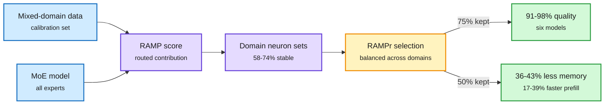

# RAMP and RAMPr: MoE skills live in neurons, not experts (2611.13975)

## TL;DR

Whether MoE experts specialize by domain (math, code) or just by token type has been contested. Tencent looks one level below the expert. **RAMP** (Routing-Aware Magnitude Profiling) scores each neuron by its contribution weighted by how often tokens are routed through it. Neuron sets picked for one domain overlap **58-74%** across different samples of that domain but only **15-24%** across domains, and they are scattered across many experts rather than concentrated in one. Tracing three fully open MoE families through training, neuron importance keeps reorganizing between pre-training checkpoints even while expert-level rankings look stable, and post-training mostly preserves the neuron ranking. **RAMPr** prunes neurons across all experts using RAMP scores with mixed-domain calibration data. At 75% neuron retention it keeps an average **91-98%** of full performance across six models. At 50% retention it cuts resident GPU memory **36-43%** and raises batched prefill throughput **17-39%**.

Prune inside every expert, not whole experts

Domain skill is spread thin across experts, so the cut has to be neuron-level and balanced across domains.

Blue is input, purple is the profiling step, amber is the pruning decision, green is the result.

## Relation to prior wiki pages

- **Refines the expert-pruning line on [model-pruning-sparsity](model-pruning-sparsity.md).** Prior MoE compression entries mostly dropped or merged whole experts. RAMPr says that throws away domain neurons scattered through the dropped expert, which explains why expert-level pruning degrades unevenly across domains.
- **Settles part of a debate the wiki has tracked.** Reports of domain-specialized experts and analyses showing routing tracks token identity can both be true: routing is token-shaped at the expert level, while domain skill is organized at the neuron level.
- **Pairs with Inkling's 4-bit expert layers (same day).** Both treat MoE expert layers as the cheapest place to remove cost: one by bits, one by neurons. They should stack, but nobody has measured pruning plus NVFP4 together.

## Open questions

- Throughput gains are for batched prefill. Decode, which is memory-bandwidth-bound, should benefit from the memory cut, but it is not reported in the abstract.
- Pruning is calibrated on a fixed domain mix. A deployment with a different mix may lose the skills it needs most.
