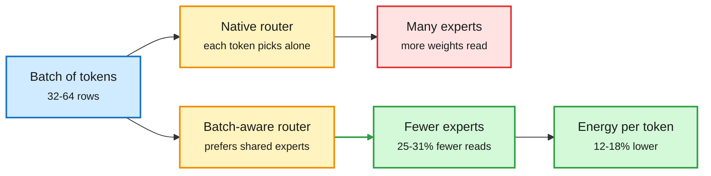

# Direct GPU energy measurements of batch-level sharing in MoE and recurrent models (2611.11696)

**TL;DR.** Energy claims for efficient models are usually inferred from operation counts. Pina and De Silva measure energy on the GPU directly and ask one question of two workloads: can the rows of a batch share computation at a measured saving? For mixture-of-experts (MoE, where each token runs through a few of many expert sub-networks) the answer is yes. On Qwen3-30B-A3B, batch-aware routing nudges tokens in a batch toward experts other tokens already need, so fewer distinct expert weights are read from memory. It reads 25-31% fewer expert weights within KL 0.05 of the original output distribution, benchmark scores stay within noise at 500 items, and energy per token falls 12-18% on a fused forward. For recurrent multi-agent RL policies the answer is no: shared activation patterns rarely last one step, and trained-in masks only work because they reduce to a narrow GRU, at 11x the energy of a small dense policy. A one-parameter rule, persistence-aware OEA, keeps the cut with about 40% fewer new experts per step than native routing at batch 32-64 (energy not yet measured).

Fewer distinct experts per batch means fewer bytes moved

Decode is memory-bound, so the saving comes from expert weights you no longer load.

Blue is the batch, amber the routing choice, red the costly path, green the measured saving.

## Relation to prior wiki pages
- **Complements** [RAMPr (11-14)](2026-11-14-rampr-moe-neuron-pruning.md), which prunes weak neurons inside every expert for 36-43% less memory. RAMPr shrinks what is stored; batch-aware routing shrinks what is read per step. They stack in principle.
- **Supports** the [model-pruning-sparsity](model-pruning-sparsity.md) page's line that sparsity is easy to find and hard to spend: the recurrent-policy result is the "unspendable" case, the MoE result the spendable one, because expert granularity matches how weights are loaded.
- **Measurement discipline** matches [How Do AI Agents Waste Your Money? (11-11)](../agentic-systems/agent-harness-engineering.md), which verified waste by deletion rather than estimation.

## Gaps
Pilot measurements on one GPU type, by the authors' own statement. No serving-engine integration (vLLM/SGLang), no quality check beyond 500 items, and OEA's energy is unmeasured.

**Source:** [arXiv 2611.11696](https://arxiv.org/abs/2611.11696) (Kurate cs.LG weekly list, 2026-11-15; `raw/kurate/2026-11-15-cs-lg.md`).
