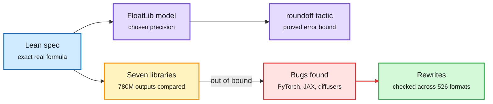

# When Rounding Breaks Machine Learning (Robert Joseph George and Sasha Rush, blog)

**TL;DR.** A formula can be proved correct over the real numbers and still be wrong in floating point. This post started from a softmax bug: in float32, the cross-entropy target gradient came out exactly zero even though the true value was nonzero and representable. The authors use FloatLib, a Lean library that models arithmetic at a chosen precision, plus a `roundoff` tactic that builds machine-checked error bounds of the form |computed minus exact| ≤ r·|exact| + a (a relative part plus an absolute allowance for underflow). They sweep all 154 TorchLean operators (162 entries with variants) across PyTorch, JAX, TensorFlow, NumPy, CuPy, ONNX Runtime and MLX, on CPU and GPU, over about 780 million outputs, then push selected original and rewritten formulas through 526 number formats. The sweep found bugs in PyTorch, JAX, TensorFlow Probability, diffusers, PyTorch Geometric, xLSTM and TorchLean itself, several never reported, with rewrites that fix them.

Same math, different library, different answer

The implementation chooses intermediate precision, summation order and when to round. That is where the bugs live.

Blue is the spec, purple the proof machinery, amber the cross-library sweep, red the failures, green the fixed formulas.

## Why it matters here
- Low-precision training is now production: [Inkling 2 Small (11-14)](2026-11-14-end-to-end-4bit-training-inkling.md) runs NVFP4 forward and MXFP8 backward, and relies on stochastic rounding to keep gradients unbiased. Every such recipe assumes the underlying operators are accurate at the format used. This post shows that assumption fails even at float32 for basic ops.
- [cuBLAS Ozaki-II (11-14)](../hardware/2026-11-14-cublas-ozaki-ii-and-glm53-two-stations.md) gets exact FP64 out of integer tensor cores. Both posts point the same way: precision is becoming something you prove, not something you assume from the dtype.
- Connects to the [quantization](quantization.md) page's error-budget thread (VC-Attention, 09-17, found low-bit attention error concentrated on the value side).

## Gaps
The captured text covers method and setup; the per-operator bug list and the transformer-block case study were beyond the capture. No FP8/FP4 hardware-kernel results are in the part we read.

**Source:** [robertj1.com blog](https://www.robertj1.com/ai4science/rounding-bugs-in-ml-formulas/) · reposted by Sasha Rush and Christian Szegedy on X (`raw/twitter/feed/2026-11-15-morning-ranked.json`).
