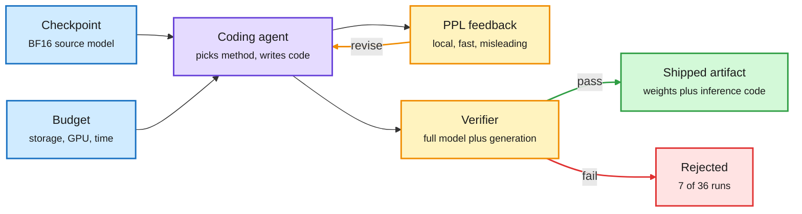

# CompressionBench: coding agents that compress LLMs

**TL;DR.** CMU (Xinrui Zhong, Zhifeng Li, Beidi Chen and colleagues) turns LLM compression into a terminal task. A coding agent gets a source checkpoint, a storage limit, a GPU runtime and a time budget. It must ship compressed weights plus working inference code, which an independent evaluator then checks. Across six agents and six model-size settings, 29 of 36 submissions pass. The best agent design per task averages only a 3.4% perplexity increase over BF16 and 77.33% downstream accuracy against 79.56% for BF16. The paper's real finding is about where agents go wrong. Local perplexity checks mislead: complete-model feedback reversed 17 of 79 earlier local rankings, and generation tests caught failures that likelihood alone missed.

The agent chooses the algorithm. The verifier decides if it counts.

Perplexity steers the search, but only full-model and generation checks catch the broken artifacts.

Blue is the given input, purple is the agent, amber is a feedback or gate step, green is a passing artifact, red is a rejected one.

## Key findings

- **It mostly works.** 29 of 36 submissions pass independent verification. The best design per task lands within 3.4% perplexity of BF16 and about 2.2 points of downstream accuracy.
- **Agents iterate well at fixed size.** They lowered perplexity in 21 of 24 revisions at nearly constant storage, so the search loop is productive.
- **Local signals lie.** Feedback from the complete model reversed 17 of 79 earlier rankings made on partial or local evaluations.
- **Likelihood is not enough.** Generation and inference tests exposed failures that perplexity did not show. This is the same lesson as "perplexity is a weak proxy for quantized quality" in human-run studies.
- **Framing.** The authors pitch compression as a measurable step of recursive self-improvement: can a compressed model still run the next compression task? That test is left open.

## How it relates to prior wiki pages

- **Extends** the agents-as-systems-engineers thread. The 11-14 digest covered an Opus-built serving engine that out-earned SGLang per GPU-hour, and [KernelSeek-style kernel agents](gpu-kernels.md) appear in [gpu-kernels](../hardware/gpu-kernels.md). CompressionBench moves the agent one layer up, from kernels and engines to the weights themselves.
- **Confirms** [When Rounding Breaks Machine Learning](2026-11-15-rounding-breaks-ml-floatlib.md) (11-15, which found unreported numerical bugs in PyTorch and JAX operators) from a different side: cheap proxies miss real failures. There it was operator error bounds; here it is perplexity versus generation.
- **Fills a gap** in [quantization](quantization.md): prior pages track human-designed recipes (NVFP4, MXFP8, Inkling's 4-bit training on 11-14). This is the first benchmark that asks whether an agent can pick and implement the recipe end to end.

## Gaps

- Six model-size settings and perplexity-centric search. No latency or throughput target, so "compressed" means smaller on disk, not faster to serve.
- Downstream accuracy is an average. Long-context and reasoning-heavy tasks, where low-bit models usually break first, are not broken out in the abstract.

## Links

- Paper: https://arxiv.org/abs/2611.06858
- Raw: `raw/dair/2026-11-16-123502-dair-academy.md`
- Concepts: [quantization](quantization.md) · [model-pruning-sparsity](model-pruning-sparsity.md) · [self-evolving-agents](../agentic-systems/self-evolving-agents.md)
