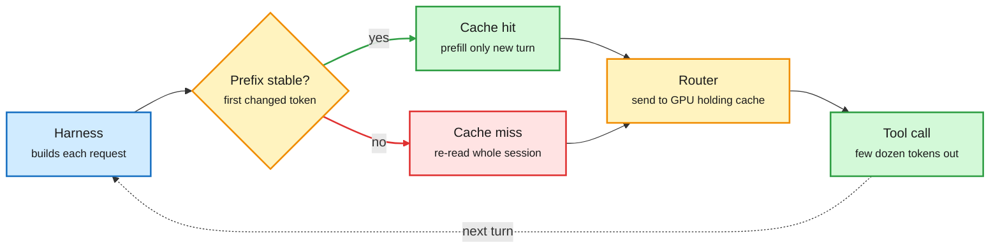

# Agent sessions are a prefix-cache problem: Together + Ollama, Bedrock, GKE and MLPerf Endpoints

**Sources:** [Making open models work for long-horizon agentic workloads](https://www.together.ai/blog/making-open-models-work-for-long-horizon-agentic-workloads) (Together AI + Ollama, 2026-11-16) · [Use prompt caching with open-weight models on Amazon Bedrock](https://aws.amazon.com/blogs/machine-learning/use-prompt-caching-with-open-weight-models-on-amazon-bedrock/) (AWS, 2026-11-16) · [Agents are sessions, not requests](https://developers.googleblog.com/agents-are-sessions-not-requests-size-gke-node-pools-for-ai-agent-sessions/) (Google Cloud, 2026-11-16) · [Vera Rubin NVL72 on MLPerf Endpoints v1.0](https://developer.nvidia.com/blog/nvidia-vera-rubin-nvl72-leads-agentic-inference-performance-on-mlperf-endpoints-v1-0/) (NVIDIA, 2026-11-16) · [agent-substrate/substrate](https://github.com/agent-substrate/substrate) (via [@Saboo_Shubham_](https://x.com/Saboo_Shubham_/status/2122570209102049332)) · raw: `raw/labs/2026-11-17-081848-labs.md`, `raw/labs/2026-11-17-103427-labs.md`

## TL;DR

Four vendors published the same lesson on the same day. An agent turn is almost all prefill: the harness resends the whole session (system prompt, tools, every file read) and gets back a tool call a few dozen tokens long. Without a prefix cache (reuse of the stored key/value state for a prompt prefix seen before), the recomputed work grows with the square of the session length: 10 equal turns cost 55 units of prefill instead of 10, and 100 turns cost 5,050 instead of 100. The cache matches only up to the first changed token, so the harness decides whether it survives. Together and Ollama list the ways harnesses break it: a timestamp or git status in the system prompt, late-loaded tool definitions inserted into the tool list instead of appended, and reasoning effort written into the first system block by GLM-5.3-Flash's chat template (changing effort mid-session re-reads the whole session). AWS shipped explicit cache breakpoints for open-weight models on Bedrock so a changing question after a shared prefix is not written to cache. Google adds the scheduling side: a coding agent session waits for its user about 78-80% of the day, so one Pod per session pays mostly for waiting; its Agent Substrate sleeps idle sessions and wakes them in under 500 ms. NVIDIA's MLPerf Endpoints submission names prefix caching, state reuse and Dynamo routing as the serving techniques behind its agentic numbers.

The harness decides whether the cache survives

Anything that changes near the top of the prompt throws away the whole session's cached work.

Blue is the harness, amber is a decision, green is cheap work, red is the expensive miss.

## Key points

- **Cache-breaking rules (Together + Ollama).** Keep the system prompt identical across turns and sessions. Put per-session facts (user name, start date) in the task message. Append late-loaded tool definitions at the end where the template allows it. Pick reasoning effort once; if you must raise it, start a fresh or compacted session. Truncated tool output must say it was truncated ("lines 1-100 of 640") or the agent misses the code it needs.
- **Engine side.** A cache only pays if the next turn reaches the GPU that holds it, so session-affinity routing is part of the cache.
- **Bedrock explicit caching.** `prompt_cache_breakpoint` markers cache layered prefixes that change at different rates. Implicit caching can write content that is never read back, which costs more on models that charge a premium for cache writes.
- **Sessions, not requests (GKE).** A turn averages 396.3 s of agent work, and at 2 prompts per hour the agent works 22% of an 8-hour day. Agent Substrate and AX run sessions so idle ones release their node.
- **MLPerf Endpoints v1.0** is the first public benchmark built around this traffic shape: coding trajectories whose context grows turn by turn and enterprise workflows that share instructions and tool definitions.

## How this relates to prior wiki pages

- **Confirms** the [prefix-cache metastability paper](2026-11-14-prefix-cache-metastability-bursts.md) (11-14), which showed a few minutes of extra load can leave a prefix-cached agent server stuck at a 10% hit ratio and half its throughput. Today's posts explain why hit ratio is the whole game: a miss re-reads 10-40K tokens.
- **Extends** [Evolving Infra](2026-11-13-evolving-infra-agent-adaptive-serving.md) (11-13), which took KV eviction hints from the agent's own context manager. Together and Ollama push the same cooperation one layer up, into the harness's prompt layout.
- **Pairs with** [SkillCache](../agentic-systems/2026-11-16-skillcache-compiled-skills.md) (11-16) and [TokenEconomizer](../agentic-systems/2026-11-17-tokeneconomizer.md) (today): those cut how many tokens a session needs; this cuts how many of them are recomputed.
- Concept pages: [KV cache](kv-cache.md), [agent harness engineering](../agentic-systems/agent-harness-engineering.md).

## Open questions

- No vendor publishes a hit-ratio number for real harness traffic. The 55-vs-10 arithmetic is idealized.
- Chat templates that encode settings (reasoning effort) in the first block are a model-design choice. A template convention that keeps all mutable settings at the tail would fix it for every harness at once.
