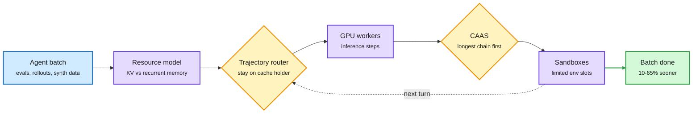

# Reducing Batch Makespan for LLM Agent Workloads through Inference-Environment Coordination (2611.16661)

**Source:** [arXiv:2611.16661](https://arxiv.org/abs/2611.16661) · HuggingFace Daily Papers 2026-11-16 · DAIR Academy pick, amplified by [@dair_ai](https://x.com/dair_ai/status/2122428754127729037) · raw: `raw/huggingface/2026-11-16-reducing-batch-makespan-for-llm-agent-workloads-through-infe.md`

**Signal:** cross-source confirmed via social (HF + DAIR on X).

## TL;DR

Agent batches (benchmark evals, synthetic-data generation, RL rollouts) finish only when their slowest trajectory finishes. Each task alternates between model inference on GPUs and environment steps in sandboxes, so each side waits on the other. The Ling team (Ant Group) schedules both together. For hybrid models that carry both a KV cache (stored attention state) and a recurrent state, a workload-based resource model splits GPU memory between the two and sets a reference concurrency: high enough to use the parallelism, low enough to avoid evicting and recomputing state. Trajectory-aware routing keeps each trajectory on the worker that already holds its cache while balancing load. When sandbox slots are scarce, admission is decoupled from environment execution and **Chain-Advancing Action Scheduling (CAAS)** gives the next free slot to the chain that has the most work left, using observed progress. A controlled-replay harness reuses recorded environment responses and durations so each optimization can be ablated alone. On BFCL, SWE-bench Multilingual, WideSearch and MCP-Atlas with Ling-3.0-Flash and Ling-3.1-Flash, makespan falls 10.4-65.0% with the same eval scores. The methods now run in the Ling-3.x training and eval pipelines.

The batch ends when the longest chain ends

Three schedulers share one goal: never let the tail trajectory wait.

Blue is the workload, amber is a scheduling decision, purple is a resource, green is the result.

## Key findings

- Makespan reductions of 10.4% to 65.0% across four agentic benchmarks, with evaluation scores unchanged.
- Hybrid (attention plus recurrent) models need a memory split decision that pure-attention serving never had to make.
- CAAS is longest-processing-time-first scheduling, estimated online from progress, applied to the environment side rather than the GPU side.
- Controlled replay makes the schedulers ablatable without rerunning real sandboxes.

## How this relates to prior wiki pages

- **Extends** [Evolving Infra](2026-11-13-evolving-infra-agent-adaptive-serving.md) (11-13: re-size the prefill/decode split to the live agent mix) from online serving to offline batches, where the metric is makespan, not latency.
- **Confirms** today's [prefix-cache discipline cluster](2026-11-17-agent-sessions-prefix-cache-discipline.md): trajectory affinity is the batch version of session-affinity routing.
- **Connects to** [LEAD-RL](../agentic-systems/2026-11-16-lead-rl-delegation-credit.md) (11-16), where subagent rollouts multiply environment calls: any multi-agent RL setup inherits this tail problem.
- Concept pages: [KV cache](kv-cache.md), [RL for LLMs](../llms-foundation-models/rl-for-llms.md), [agent training environments](../agentic-systems/agent-training-environments.md).

## Gaps

- Results are on Ling's own hybrid models. Transfer to pure-attention or MoE (mixture-of-experts) targets is not shown.
- The resource model's reference concurrency is workload-specific; how often it must be refit is not reported.
- No alphaxiv overview was available; this page is built from the abstract and DAIR's summary.
