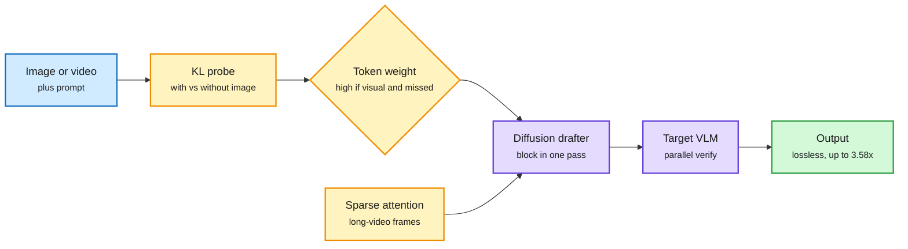

# MMFlash: faster speculative decoding for vision-language models (2611.18482)

**Source:** [arXiv:2611.18482](https://arxiv.org/abs/2611.18482) · HuggingFace Daily Papers 2026-11-16 (#5) · raw: `raw/huggingface/2026-11-16-mmflash-faster-speculative-decoding-for-vision-language-mode.md`

## TL;DR

Speculative decoding lets a small drafter propose tokens that the big target model verifies in one parallel pass. Diffusion drafters such as DFlash propose a whole block of tokens in one forward pass, but they were built for text. MMFlash first measures **visual dependence** per token: the KL divergence between the target's next-token distribution with and without the image. Draft acceptance falls from 46% in the least visually dependent quartile to 22% in the most dependent one, and multimodal training alone does not close the gap. The fix is a training reweighting: upweight visually dependent tokens that the drafter currently predicts badly. For long videos it adds sparse attention in the drafter to drop redundant frames. Result: lossless speedups up to 3.58x, beating EAGLE-3 by up to 195.4% and DFlash by up to 17.1%.

The drafter fails exactly where the image matters

Reweighting training toward image-dependent tokens is the whole method.

Blue is input, amber is the training signal, purple is a model, green is the result.

## How this relates to prior wiki pages

- **Extends** the [speculative decoding](speculative-decoding.md) page's "acceptance is content-dependent" thread (DLoop 10-09 adapted drafting depth to confidence; AgSpec 10-03 drafted from an agent's own text). MMFlash names a new axis of difficulty: dependence on a non-text modality.
- **Same move as TIP-style token weighting** in distillation: most tokens are easy, so concentrate the training signal on the few the student gets wrong. See [knowledge distillation](knowledge-distillation.md).

## Gaps

- Speedups are reported at what appears to be low batch; the batch-size curve is not in the abstract.
- The visual-dependence probe needs two target passes per training token; its training-time cost is not stated.
