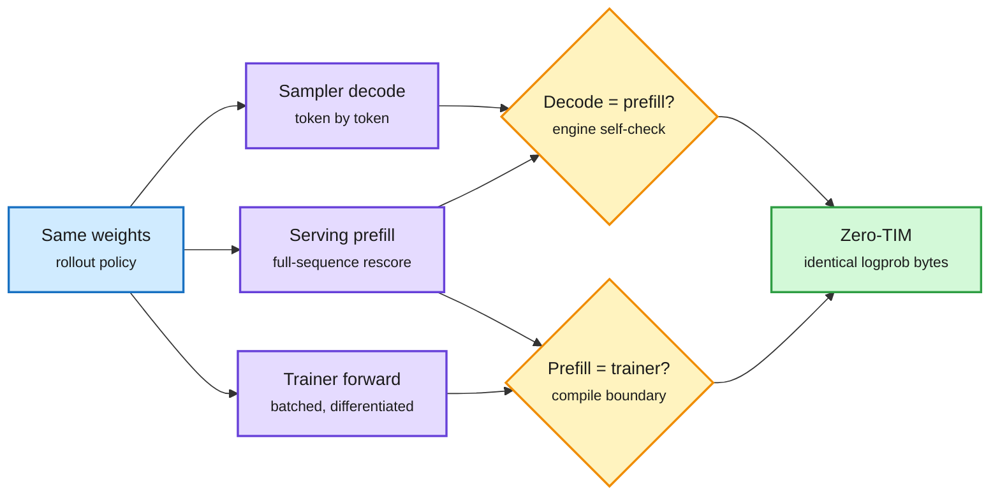

# Zero-TIM: bitwise-identical logprobs between sampler and trainer for on-policy RL on TPU

**Source:** [Unlocking Stable On-Policy RL on TPU with Bitwise-Zero Train–Inference Mismatch](https://developers.googleblog.com/unlocking-stable-on-policy-rl-on-tpu-with-bitwise-zero-traininference-mismatch/) (Google, Tunix team, 2026-11-16) · raw: `raw/labs/2026-11-17-081848-labs.md`

## TL;DR

In LLM reinforcement learning the sampler (the serving engine that generates rollouts and records each token's logprob) and the trainer (which recomputes logprobs and gradients in batched forward-backward passes) run different code paths. With identical weights they can still disagree, because floating-point addition is not associative: a different reduction order rounds differently, and bfloat16 exposes this sharply. The training schedule is on-policy, but the arithmetic adds a hidden off-policy gap that compounds over multi-turn trajectories. Google's Zero-TIM (zero train-inference mismatch) in Tunix makes sampler decode, serving prefill and trainer forward produce **bitwise-identical** logprobs for every sampled action, verified on 64 TPU v5p chips (8-way data parallel by 8-way tensor parallel). The recipe has four parts: batch-invariant Pallas kernels that fix within-shard accumulation order and accumulate in float32 (covering attention and MLP projections, the LM head, RMSNorm and SwiGLU casts); explicit cross-shard reduction order (ppermute moves partials, every rank adds them in the same source-rank order instead of trusting a collective); one shared log-softmax and action-selection tail; and custom differentiation rules so the trainer reuses the serving prefill forward. Serving prefill is the middle checkpoint: decode-vs-prefill isolates serving-engine drift, prefill-vs-trainer isolates the compile and autodiff boundary.

Three paths, one set of bits

Prefill is the checkpoint that tells you where a mismatch enters.

Blue is the shared policy, purple is an execution path, amber is a bitwise check, green is the contract met.

## How this relates to prior wiki pages

- **Pattern (fourth item in a week):** bit-level numerics as an engineering target. [Sable](2026-11-12-sable-bit-exact-verifiable-inference.md) (11-12) made an integer-only transformer whose every rounding is fixed so its output is provable. [When Rounding Breaks ML](2026-11-15-rounding-breaks-ml-floatlib.md) (11-15) found real library bugs where float rounding broke formulas proved correct over the reals. Zero-TIM applies the same discipline to RL stability.
- **Contradiction to track:** the [OPD mismatch budget](2026-11-11-opd-mismatch-budget.md) paper (11-11) found on-policy distillation tolerates sizeable train-inference mismatch below a calibrated budget, while RL does not. Zero-TIM is the "pay for zero" answer; OPD's budget is the "measure and tolerate" answer. Which is cheaper for RL at scale is open.
- Concept pages: [RL for LLMs](../llms-foundation-models/rl-for-llms.md), [GPU kernels](../hardware/gpu-kernels.md), [quantization](quantization.md).

## Gaps

- The post (as captured) gives no throughput cost of batch-invariant kernels versus the fast default path, and no training-curve comparison with and without Zero-TIM.
- Verified at 64 chips; frontier RL runs thousands.
- Quantized rollout engines (common for cheap rollouts) cannot be bitwise-equal to a bf16 trainer by construction, so Zero-TIM rules them out.
