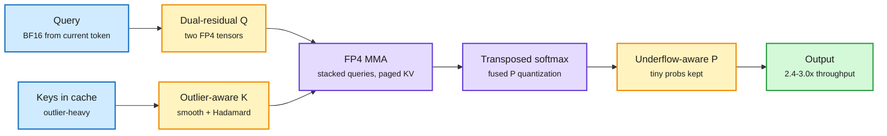

# BitDecoding-FP4: native FP4 KV cache decoding via algorithm-system co-design (2611.09825)

**Sources:** [arXiv:2611.09825](https://arxiv.org/abs/2611.09825) · [HF Papers](https://huggingface.co/papers/2611.09825) · [code](https://github.com/OpenBitSys/BitDecoding-FP4) · raw: `raw/huggingface/2026-11-17-bitdecoding-fp4-native-fp4-kv-cache-decoding-via-algorithm-s.md`

## TL;DR

The KV cache (stored attention keys and values for every past token) sets both the memory footprint and the bandwidth bill of long-context decoding. Blackwell's FP4 Tensor Cores can run attention directly on 4-bit microscaled data (NVFP4: 16-value blocks with an FP8 E4M3 scale; MXFP4: 32-value blocks with a power-of-two scale), but existing FP4 KV systems quantize naively and lose a lot of accuracy, while the accurate 4-bit KV methods use vector codebooks whose lookups kill throughput. BitDecoding-FP4 closes the gap by fixing three specific error sources and then removing the softmax as the new bottleneck. **Dual-Residual Query Quantization** stores the query as two FP4 tensors (value plus residual) so the FP4 matmul sees a near-exact query: query-logit error falls from 60% to 1%. **Underflow-Aware Probability Scaling** stops the E4M3 scale from rounding long-context attention probabilities (which get tiny at 100K+ tokens) to zero. **Outlier-Aware Key Quantization** combines static smoothing, a Hadamard rotation and a scale search to tame key outliers under per-token scaling. On the system side, a transposed softmax with fused probability quantization and a stacked-query MMA over paged KV keep the Tensor Cores fed. Result: within 0.5 points of BF16 KV accuracy with NVFP4 (1 point with MXFP4) across dense and MoE models with GQA and MLA, it tracks BF16 KV during RL rollouts, and it gives **2.4-3.0x peak serving throughput** over BF16 KV on B300 with Qwen3-4B and Qwen3-30B-A3B.

Three error fixes make FP4 attention accurate, one kernel fix makes it fast

Each red box is an error source that vanilla FP4 KV leaves in; each amber box is the fix.

Blue is input, amber is an error fix, purple is the FP4 kernel path, green is the result.

## Key claims

- Vanilla FP4 query quantization produces ~60% query-logit error; splitting the query into value + residual FP4 tensors brings it to ~1%.
- At long context, softmax probabilities fall below what an E4M3 scale can represent; without explicit scaling they round to zero and the long tail of attention silently disappears.
- Accuracy: within 0.5 points of BF16 KV (NVFP4), 1 point (MXFP4), across GQA and MLA models, dense and MoE.
- Tracks BF16 KV in RL rollouts, which matters because train-inference mismatch is a known RL failure source.
- 2.4-3.0x peak serving throughput vs BF16 KV on B300 (Qwen3-4B, Qwen3-30B-A3B).

## How it relates to prior wiki pages

- **Extends the "the softmax becomes the critical path" law** on [GPU kernels](../hardware/gpu-kernels.md), first stated for [VC-Attention (09-17)](2026-09-17-vc-attention-low-bit-value-smoothing.md): once the two attention matmuls move to low-bit Tensor Cores, the softmax is what remains on the general path. BitDecoding-FP4's transposed softmax is the explicit fix.
- **Fills a gap left by the NVFP4 QAD checkpoint posted the same day** ([summary](2026-11-18-qwen38-nvfp4-qad-checkpoint.md)), whose card says KV-cache quantization is not part of the recipe and the KV stayed BF16. Weights went to 4 bits months ago; the KV cache, which dominates bytes at long context, is the remaining BF16 tensor.
- **Speaks to the train-inference mismatch thread** from [Zero-TIM (11-17)](2026-11-17-zero-tim-bitwise-rl-tpu.md): an FP4 KV that tracks BF16 in rollouts is a precondition for using it in RL sampling at all.
- Connects to [quantization](quantization.md) and [KV cache](kv-cache.md).

## Gaps

- Evaluated at 4B and 30B-A3B only; no frontier-scale MLA model in the serving numbers.
- Peak throughput is a capacity number (more sequences fit); per-token latency at fixed batch is less clear from the abstract.
- B300 only; no Hopper fallback (FP4 Tensor Cores are Blackwell-only).

## Research angle

The three error sources are query, probability and key. The value side, which VC-Attention found carried most of the low-bit attention error in video diffusion, is not named. Whether FP4 values are already benign in LLM decoding, or whether the remaining 0.5 points live there, is the obvious next ablation.
