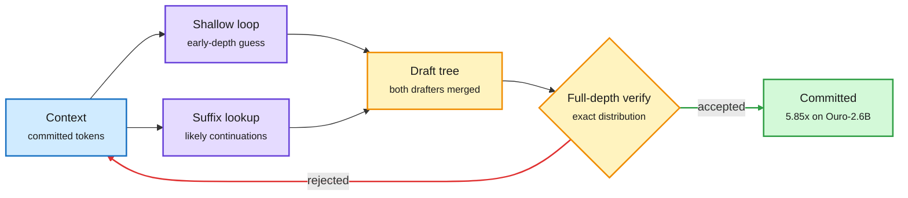

# Looped and speculative decoding shorts: LoopFill, Latent Feedback, Energy-Based Reasoners, Sciforium

**Sources:** [LoopFill, arXiv:2611.19649](https://arxiv.org/abs/2611.19649) · [Latent Feedback Is a Compute and Data Amplifier, arXiv:2611.20404](https://arxiv.org/abs/2611.20404) · [Energy-Based Reasoners, arXiv:2611.08977](https://arxiv.org/abs/2611.08977) · Sciforium's DeepSeek-V4.1-Flash on MI355X ([@rohanpaul_ai](https://x.com/rohanpaul_ai/status/2122781142311117197), [@omarsar0](https://x.com/omarsar0/status/2122780881370632457)) · raw: `raw/huggingface/2026-11-17-*.md`, `raw/twitter/feed/2026-11-18-morning-ranked.json`

## TL;DR

Four results on spending depth and drafts more cleverly.

- **LoopFill (training-free).** Looped Transformers reuse the same block several times per token, which saves parameters but makes decoding slow: each token needs several sequential passes. Earlier pipelined self-speculation let tokens sit at different loop depths in one batch, but a token had to reach the drafting depth before the next could enter. LoopFill merges **multi-token suffix drafts** (lookups of likely continuations) with **shallow-loop predictions** into one draft tree, so a suffix match can immediately extend a shallow guess and several future tokens enter the pipeline together. The shared block scores candidates at different depths in one batch; full-depth verification keeps the output distribution exact. **Average 5.85x over greedy decoding** across seven benchmarks on Ouro-2.6B.
- **Latent feedback.** Feeding each token's top-layer hidden state into the next token's input is tested against a vanilla Transformer spending the same compute on extra epochs. Across a ladder of sizes, unique-data budgets and epoch counts (both models tuned at every point), latent feedback reaches the same loss **with less compute at fixed data and with less unique data at fixed epochs**. The savings grow with unique data per parameter and with repetition. A single fitted scaling law treats latent feedback as a Transformer with more parameters. Exception: when unique data is scarce relative to model size, which today's models are far from.
- **Energy-Based Reasoners.** A looped reasoner learns an energy function over latent states and runs its loop as gradient descent on that energy, so the energy also tells it **when to stop**. Exploration-based training shapes the landscape. 99.9% on Sudoku-Extreme with **345x less inference compute** than the next-best model.
- **Sciforium (practitioner).** DeepSeek-V4.1-Flash at **1,129 output tokens/s at P90 on 4 AMD MI355X**, original weights. The gain is a drafter tuned on customer traffic, so longer drafted runs survive verification and 7-token drafts pay off; kernel work fused small ops (mHC, projections) and fused all-reduce with compute. They also published what did not help.

LoopFill fills the loop pipeline with two kinds of guesses

Suffix lookups extend shallow-loop guesses, so several tokens enter the loop at once.

Blue is context, purple are the two drafters, amber is tree and verification, green is accepted output, red is the retry path.

## Relation to prior pages

- **Looped models get their serving fix.** [Looped transformers](../llms-foundation-models/looped-transformers.md) has tracked the latency cost of sequential loops since June. [LoopVQ (11-06)](2026-11-06-loopvq-and-multi-layer-indexer.md) attacked the loop's KV memory; LoopFill attacks its latency. With [Loopback (11-17)](../llms-foundation-models/2026-11-17-qwen4-max-and-loopback-transformer.md) improving training, all three looped-model costs (training, memory, latency) now have a published answer.
- **Latent feedback is the data-wall argument for recurrence.** It frames a loop-like mechanism as a substitute for repeated epochs when unique data runs out, which ties [scaling laws](../llms-foundation-models/scaling-laws.md) to the looped thread.
- **Traffic-tuned drafters confirm the 11-06 to 11-09 drafter race** on [speculative decoding](speculative-decoding.md): acceptance rate on real traffic, not draft architecture, decides whether long drafts pay. Same-day [NVIDIA indexer post](2026-11-18-nvidia-sparse-attention-indexer-codesign.md) adds that long drafts are nearly free for sparse-attention indexers up to one Tensor Core tile.
- **EBR's stop signal** is the model-level version of the termination-lag problem in coding agents ([summary](../agentic-systems/2026-11-18-where-agent-compute-goes.md)).

## Gaps

- LoopFill is shown on a 2.6B looped model; no frontier-size looped model is public.
- EBR is evaluated on algorithmic puzzles only.
- Sciforium is a vendor blog; P90 at what concurrency is not captured.
