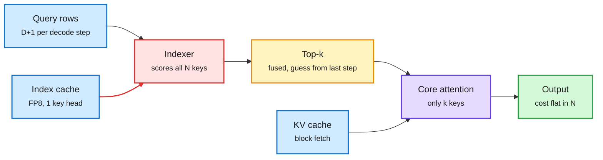

# NVIDIA: co-designing sparse attention for long-context inference

**Sources:** [NVIDIA Developer blog](https://developer.nvidia.com/blog/co-designing-sparse-attention-for-efficient-long-context-inference/) (2026-11-17, Liu, Bhatia, Jain, Chandran, Darvish Rouhani) · raw: `raw/labs/2026-11-18-001416-labs.md`

## TL;DR

Trained sparse attention (DeepSeek DSA, GLM 5.x, Qwen QSA, MiniMax MSA, NSA, MoBA) lets each query attend to only its top-k keys (a few thousand), so core attention stops growing with context. But the **indexer** that picks those keys still scores all N keys, so the cost moves rather than disappears: at 128K input tokens, indexer plus Top-k take **47% of a DeepSeek V3.2 prefill layer**. NVIDIA sweeps the indexer's design knobs with a production FP8 kernel and turns the results into model-design rules. The indexer is one batched matmul with a fused epilogue, and its arithmetic intensity (FLOPs per byte moved) is proportional to **group size G = query heads / key heads** and, in decode, to **D+1 query rows per step** where D is the speculative draft length. Context length and compression ratio scale total work but not intensity.

Sparse attention moves the cost into the indexer

Core attention scales with k; the indexer still scales with every key in the cache.

Red is the part that still grows with context, amber is the selection step, purple is the cheap core attention, green is the result.

## The design rules

1. **Use one indexer key head (KH = 1) with a cross-head reduction.** Reducing G query heads to one logit per key gives G times more FLOPs per byte written. Designs without the reduction (MiniMax MSA, MoBA) lose that factor; adding key heads grows decode runtime linearly.
2. **In decode, extra query heads are nearly free.** Decode is memory-bound on reading the index cache, so runtime moved only 2% while G grew 16x. In prefill (compute-bound), doubling G from 8 to 16 cost 1.66x, not 2x, because the FP32 logit write dominates at small G.
3. **Speculative drafts are nearly free for the indexer** while all D+1 query rows (times G) fit in one Tensor Core tile of roughly 200-256 rows. Past that, a second pass over the key cache doubles cost.
4. **Indexer head dimension 128 or 256** balances Tensor Core utilization against decode memory traffic; FP16 epilogue and accumulation add throughput.
5. **Score fewer keys** (compression, hierarchical indexing, index sharing across layers) to cut both indexer and Top-k work without changing intensity.
6. **Fuse Top-k into the indexer kernel** to avoid writing and re-reading logits, and reuse the previous decode step's selection as a starting guess: **2.1-2.4x faster Top-k** (Guess-Verify-Refine, in TensorRT-LLM; open version in FlashInfer).
7. **Select large blocks** so core attention fetches keys in bulk and shares them across query heads.

## Relation to prior pages

- **Confirms the indexer-is-the-bottleneck thread** on [attention mechanisms](../llms-foundation-models/attention-mechanisms.md): [Latent Sparse Attention (11-04)](2026-11-04-latent-sparse-attention-10m-context.md) found the indexer is the quadratic term at 10M tokens, and the [Multi-layer Indexer (11-06)](2026-11-06-loopvq-and-multi-layer-indexer.md) found the DSA indexer scan dominates decode. NVIDIA now gives the hardware reason: intensity is set by G and D+1, not by N.
- **Ties sparse attention to speculative decoding** ([concept](speculative-decoding.md)): draft length is a free intensity lever for the indexer up to one tile, so drafter depth and indexer shape should be co-designed.
- **Tencent's Hy4 flash, released the same day** ([summary](../llms-foundation-models/2026-11-18-hy4-flash-k2-horizon-open-models.md)), interleaves sparse IndexPool layers with sliding-window layers 1:3 and selects up to 2,048 tokens by group: an architecture that already follows rules 5 and 7.
- Connects to [KV cache](kv-cache.md) and [GPU kernels](../hardware/gpu-kernels.md).

## Research angle

Rule 3 implies the optimal speculative draft length differs by layer type in a hybrid model: dense and SWA layers want whatever the acceptance rate supports, while sparse layers have a hard tile ceiling. Nobody has published a drafter that sizes D with the indexer tile in mind.
