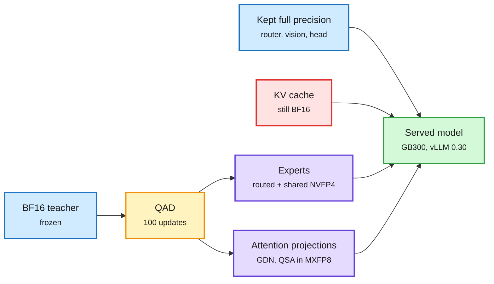

# NVIDIA Qwen3.8-Flash-Next-NVFP4-QAD: 4-bit shared experts, repaired in 100 steps

**Sources:** [model card](https://huggingface.co/nvidia/Qwen3.8-Flash-Next-NVFP4-QAD) (2026-11-17) · [NVIDIA Model Optimizer](https://github.com/NVIDIA/Model-Optimizer) · raw: `raw/labs/2026-11-17-180314-labs.md`

## TL;DR

NVIDIA posted an experimental, more aggressive quantized checkpoint of Qwen3.8-Flash-Next (a hybrid of Gated DeltaNet linear attention, Qwen Sparse Attention and MoE). The earlier NVFP4 release quantized only the routed experts. This one also puts the **144 shared-expert matrices in NVFP4** and the GDN, sparse-attention q/k/v/o and indexer projections in **MXFP8**, then repairs the damage with **QAD** (quantization-aware distillation: a fake-quantized student with full-precision master weights learns to match a frozen BF16 teacher). Only **100 optimizer updates** (51,200 sequences up to 16K tokens) were run. Scores sit within noise of BF16: GPQA-Diamond 91.60 vs 92.05, IFBench 79.93 vs 79.60, SciCode 51.11 vs 50.22, MMMU-Pro 77.34 vs 77.75, and Terminal-Bench 2.1 identical at 612/712 (bootstrap 95% CI for the difference: -2.95 to +3.23 points). Weights are 129.7 GB.

What got squeezed, and what was left alone

The sensitive pieces (router, vision, KV cache) stay at original precision.

Blue is input or untouched, amber is the repair step, purple is quantized, red is the unquantized gap, green is the served model.

## Why it matters

- **The card is unusually honest.** It states that QAD accuracy gains are "not statistically established", that retry/timeout accounting is incomplete for Terminal-Bench, that MTP (the built-in multi-token speculative drafter) was not validated, and that only GB300 + vLLM 0.30.0 + its serving helpers are supported. This is the right template for quantized releases.
- **Shared experts were the conservative holdout.** Shared experts see every token, so they were usually left in higher precision. Quantizing them too, with near-zero measured loss after 100 QAD steps, says the repair budget for a hybrid MoE is tiny.
- **The KV cache is now the BF16 island.** Same-day [BitDecoding-FP4](2026-11-18-bitdecoding-fp4-kv-cache.md) is the missing piece.

## Relation to prior pages

- Extends [End-to-End 4-Bit Training (11-14)](2026-11-14-end-to-end-4bit-training-inkling.md): Thinking Machines trained in NVFP4 from the start; NVIDIA shows post-hoc QAD reaches parity cheaply on an existing hybrid.
- [Quantization](quantization.md) concept page; [CompressionBench (11-16)](2026-11-16-compressionbench.md) asked whether agents can pick recipes like this one.
