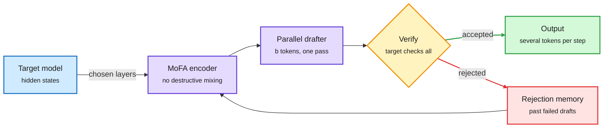

# DNeo (2611.21925)

**TL;DR.** In speculative-diffusion decoding, a small parallel drafter proposes b tokens in one forward pass and the large target model verifies them all at once. Recent drafters (DFlash, DSpark) get better drafts by reading hidden-state features from the target ("feature encoding"). DNeo argues that encoding is broken in three ways: it is lossy (the projection mixes the residual features destructively, an effect the authors call residual mixing), memory-less (it forgets proposals the target already rejected), and samples target layers uniformly (missing the most useful hidden states). The fix is Mixture-of-Features Attention (MoFA) with a working memory of rejected proposals, plus 2-tap causal convolutions, prefix-only cross-attention and non-uniform layer selection. Result: 1.3x faster generation than DFlash-2 with the same drafter size and identical output quality.

The drafter remembers what the target already rejected

Better drafts come from reading the right target features, not from a bigger drafter.

Blue is the target's features, purple the drafter path, amber verification, green accepted output, red the rejection loop feeding memory.

## How it relates to prior wiki pages

- **Third attack this week on drafter conditioning.** [MMFlash (11-17)](2026-11-17-mmflash-multimodal-speculative-decoding.md) showed diffusion-drafter acceptance falls from 46% to 22% as a token depends more on the image; [Sciforium's traffic-tuned drafter (11-18)](2026-11-18-looped-and-speculative-decoding-shorts.md) made 7-token drafts pay by training on real traffic. DNeo fixes the feature pipe itself. The common claim: acceptance is limited by what the drafter sees, not by its size.
- **DSpark is now production**: RadixArk recommends SGLang with DSpark speculative decoding for its DaisyRose-27B release (see [efficiency shorts](2026-11-19-efficiency-shorts.md)), so DNeo's 1.3x over DFlash-2 targets a stack people actually ship.
- Concept page: [speculative-decoding](speculative-decoding.md).

## Gaps

The abstract reports speed relative to DFlash-2 but not acceptance-length breakdowns per fix, batch-size sensitivity, or long-context behavior where rejection memory could grow.

**Raw source:** [HF listing](../../raw/huggingface/2026-11-18-dneo-your-parallel-draft-model-needs-better-target-feature-e.md) · [arXiv](https://arxiv.org/abs/2611.21925)
