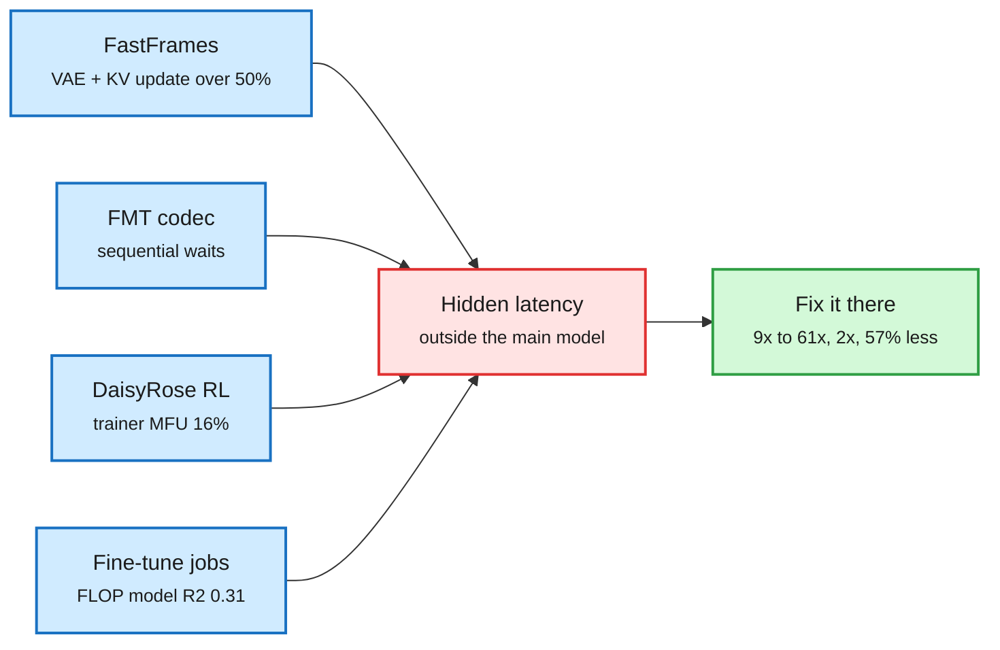

# Efficiency shorts (2026-11-19)

**TL;DR.** Shorter items from the 11-18 Hugging Face list and two Hugging Face blog posts. The common thread: the cost that matters is often not the one the FLOP count shows (VAE decode and KV updates in video, sequential waits in codecs, MFU in RL trainers, eval overhead in fine-tuning jobs).

The slow part is rarely the part you counted

Each item found the real bottleneck outside the main matmuls.

Blue is each item, red the overlooked cost, green the result of fixing it.

## Items

- **FastFrames (Apple + Cornell, 2611.23226).** Profiling autoregressive video diffusion shows VAE decoding and KV cache updates are over half of end-to-end latency (one VAE decode costs about 3.5 DiT passes, per AI Weekly). Replacing them with lightweight alternatives gives a 1.3B model at 36 ms/frame (28 responses/s) on one B200, matching a model about 8x slower; a 14B variant runs 45 ms/frame on 8x B200. A KV-update cost in a video model is the same lesson as the LLM serving pages: the cache bookkeeping, not attention, can dominate. ([arXiv](https://arxiv.org/abs/2611.23226))
- **FMT, Fixed-step Multiscale Tree (2611.23108).** Learned lossless image codecs are smaller but take seconds to decode because the network waits on values it conditions on and the arithmetic decoder reads them one at a time. FMT stores a coarse-to-fine tree of independent steps, predicts each step at once on GPU and decodes in parallel rANS lanes, so any image decodes in a fixed number of sequential steps. With no network it beats NVIDIA HTJ2K on size and speed; with a large one it decodes Kodak 9-61x faster than learned codecs on the same A100 at equal or smaller size. ([arXiv](https://arxiv.org/abs/2611.23108))
- **DaisyRose-27B (RadixArk, HF blog).** RL on Qwen3.8-27B with the open Miles framework: 1,200 long-horizon agent tasks (sessions up to 1M tokens), 18 days on 144 H200s (128 inference, 16 training), 63,000 GPU-hours. Terminal-Bench 4.1 pass@1 5.6% to 12.0%; SWE-Bench Pro v2 91.3 to 94.7. Their backend hit 37% MFU (model FLOPs utilization) vs 16% for the open Megatron-based trainer, about 57% less GPU time; the gap grows to 6.2x on Qwen3.6-35B-A3B and over 10x on a ~300B GLM. AgentENV ran ~944K sandboxes at ~80% lower cost than cloud sandbox vendors. Shipped in BF16, FP8 and NVFP4, served with SGLang + DSpark speculative decoding. ([HF blog](https://huggingface.co/blog/RadixArk/daisyrose-27b-pushing-the-frontier-of-post-trainin))
- **Why fine-tuning takes longer than the FLOPs say (Dharma-AI, HF blog).** 272 production SFT runs (~7,382 GPU-hours on H200). The textbook 6·P·D/(N·peak·MFU) estimate scores R² 0.31 at 30% MFU and gets worse at higher assumed MFU; Calculon scores R² -0.51. A 24-feature CatBoost model scores R² 0.98, MAE 1.71 h. The top feature is the size of the eval set, not model size. ([HF blog](https://huggingface.co/blog/Dharma-AI/predicting-fine-tuning-time))
- **Agentic on-policy distillation reshapes ReAct patterns (2611.19244).** OPD (the student learns from a teacher's scores on its own outputs) transfers across domains unevenly. General-reasoning supervision cut math tool attempts from 70.4% to 14.4% while lifting accuracy 16.7% to 38.0%. ALFWorld supervision crashed τ²-bench from 41.5% to 6.6% with tool calls that ignore user-information dependencies. Selective OPD keeping the top 95% of positions recovers τ² from 11.5% to 29.9%. ([arXiv](https://arxiv.org/abs/2611.19244))
- **M3OPD-Reasoner (2611.23034).** Open multimodal recipe: train one GSPO teacher per domain (image STEM, perception, video) from Qwen3.5-9B, merge with multi-teacher OPD, then run mixed RL on the same prompts. The student matches each teacher in-domain, and RL on top improves further with no collapse. All data, code and checkpoints released. ([arXiv](https://arxiv.org/abs/2611.23034))
- **Regularized Score Centering (2611.21791).** Asynchronous RL is fast but stale policies and train/inference numerical mismatch destabilize it. RSC adds a reverse-KL penalty toward the behavior policy on top of score centering (with or without truncated importance sampling). +14.3% on AppWorld and 9.9x the best baseline on BabyAI. Relevant to the [quantization noise-floor](2026-11-19-quantization-noise-floor.md) finding that engines disagree: train/inference mismatch is the RL face of the same nondeterminism. ([arXiv](https://arxiv.org/abs/2611.21791))
- **The novelty exposed (2611.20003).** 39 of 48 architectures added to transformers in 2025 borrow at least two of three core blocks (usually from Llama). In 40 sampled tech reports, only 19 of 73 novelty claims have a controlled with/without ablation, 4 report more than one training run, and 1 discloses data mixture, token count and compute together. ([arXiv](https://arxiv.org/abs/2611.20003))
- **Attention at Absolute Zero (2611.11937).** A higher-order attention layer over item pairs that reads "witnesses" at zero temperature and passes only count-comparison bits. Exact on 99.95% of max-retrieval sets 1,000x larger than training; lifts a frozen open 7B on CLUTRR from 33% to 65% with only a small read-in trained. A length-generalization result, not an efficiency one, but it argues soft attention's failures at size are structural. ([arXiv](https://arxiv.org/abs/2611.11937))

## How it relates to prior wiki pages

- FastFrames and FMT extend the [11-18 sparse-attention indexer page](2026-11-18-nvidia-sparse-attention-indexer-codesign.md) lesson (the cost moves to the bookkeeping) to video and codecs.
- Agentic OPD and M3OPD add to [knowledge-distillation](knowledge-distillation.md): OPD is now the default merge step, and its negative transfer is measurable per domain.
- DaisyRose's MFU gap is the training-side version of [compute-economics](../hardware/compute-economics.md): utilization, not GPU count, sets RL cost.

**Raw sources:** [raw/huggingface/2026-11-18-*](../../raw/huggingface/) · [raw/rss HF blog posts](../../raw/rss/2026-11-18-huggingface-blog-daisyrose-27b-pushing-the-frontier-of-post-training-eff.md)
