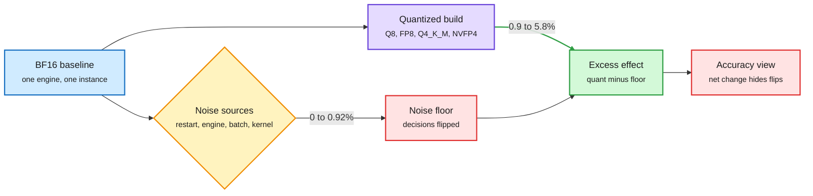

# The Noise Floor of a Quantization Comparison (Cloudflare, 2611.15671)

**TL;DR.** When you compare a quantized model to its BF16 original, you usually change more than the weights: the serving engine, the server instance, the batch size and sometimes the kernel the library picks. This pre-registered study measures each of those non-quantization sources on 2,400 public decisions from two Cloudflare decision models (Clef-flash 9B and Clef 27B) on an NVIDIA GB10, then reports quantization effects only as the excess over that noise. Non-quantization sources flip 0 to 0.92% of decisions. 8-bit flips about 0.9-2.1%, 4-bit about 3.5-5.8%. Every 4-bit effect clears the noise floor; FP8 does not sit inside restart noise, which the authors had predicted it would. Accuracy hides most of the movement: Clef's Q4_K_M build moves net accuracy by six questions out of 31,275 while 436 individual decisions get worse.

Half the "quantization effect" can be the stack, not the bits

Measure every non-weight change first, then report quantization as the excess.

Blue is the baseline, amber the non-quantization changes, purple the quantized model, green the clean effect, red what usually gets missed.

## Key findings

- **llama.cpp restarts are bit-identical** on every record for both models. vLLM restarts are not: they flip 0, 5 and 20 decisions at BF16, FP8 and NVFP4 on Clef-flash, and 4, 0 and 22 on Clef.
- **An engine change at BF16 flips 6 to 16 decisions, a batch-size change 8 to 15**, and the Gated DeltaNet kernel that transformers selects on its own (depending on which packages are imported) flips 10 to 14.
- **Quantization inside one engine moves more**: 0.88% / 1.04% at Q8_0, 2.12% / 1.62% at FP8, 5.79% / 3.50% at Q4_K_M, 5.79% / 5.67% at NVFP4 (Clef-flash / Clef).
- **Two of five pre-registered predictions failed**, and failed again on the 27B: FP8 is not inside restart noise, and an engine change moves fewer decisions than 8-bit quantization.
- **Net accuracy is the wrong metric for decision models.** Q4_K_M: -0.02 points [-0.20, +0.16] net, yet 436 decisions worse. NVFP4 costs 0.95 and 0.65 points.

## How it relates to prior wiki pages

- **Extends** [the 11-15 rounding page](2026-11-15-rounding-breaks-ml-floatlib.md), which showed that the operators under low-bit recipes are not exact. This paper puts a number on how much that inexactness moves real decisions, and shows it is smaller than 4-bit quantization but comparable to 8-bit.
- **Confirms** the [SABLE bit-exact inference page (11-12)](2026-11-12-sable-bit-exact-verifiable-inference.md) argument that serving nondeterminism is a measurement problem, not just a reproducibility nuisance.
- **Complicates** the [11-18 BitDecoding-FP4](2026-11-18-bitdecoding-fp4-kv-cache.md) and Qwen3.8 NVFP4-QAD claims of "within noise of BF16": those comparisons report accuracy, which this paper shows can hide hundreds of flipped decisions.
- Concept page: [quantization](quantization.md).

## Gaps

Two decision models, one GPU (GB10), classification-style outputs. No long-generation or agentic tasks, where flips compound across steps. The third-instance result for Clef's quantized builds is exploratory.

**Raw source:** [HF listing](../../raw/huggingface/2026-11-18-the-noise-floor-of-a-quantization-comparison-engine-restart.md) · [arXiv](https://arxiv.org/abs/2611.15671)
