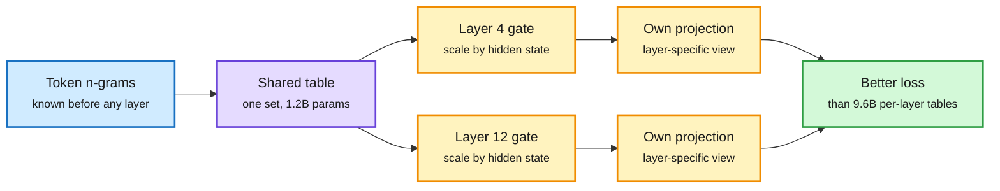

# Chorus: Shared N-gram Embeddings with Layer-wise Adaptation (2611.23386)

**TL;DR.** N-gram embedding tables (large learned lookup tables keyed by short runs of consecutive tokens, added to the model's input or middle layers) give a language model extra capacity for almost no compute. That is the idea behind DeepSeek's Engram. Current designs give each layer its own table, which is expensive in memory and stops layers sharing what they learn. A single shared table performs poorly because every layer gets the same vector. Chorus keeps one shared set of tables and lets each layer read it differently: the layer rescales the embedding's components using factors computed from its own hidden state, then applies its own projection. With 1.2B table parameters it predicts text better than FactorEngram and Engram do with 9.6B, an 87% smaller table. It beats Engram, TN-gram and FactorEngram at every table size tested from 20M to 9.6B. With the Ember optimizer, table optimizer state shrinks 99.2% versus AdamW.

One table, many readers

Each layer adapts the shared lookup with its own gate and projection.

Blue is the token-ID address, purple is the shared table, amber is per-layer adaptation, green is the result.

## Relation to prior wiki pages
- **Third route on the table-size problem.** The [conditional memory page](conditional-memory-embeddings.md) has tracked two: keep the full table in cheap memory and prefetch it (DeepSeek's Engram in production, 10-22) or compress it into HBM ([Conditional Program, 2-bit codes, 10-22](2026-10-22-conditional-program-ngram-two-bits.md); [OPTIC, 100x cross-layer PLE compression, 10-28](2026-10-28-optic-ple-compression.md)). Chorus removes the per-layer duplication itself, the same cross-layer redundancy OPTIC exploited after training, but at design time.
- Token-ID addressing is preserved, so Chorus keeps the prefetch advantage SemiAnalysis credited Engram with.
- Tencent's Hy4 flash (11-18) put 63.5B of its 220B parameters in n-gram tables; an 87% cut would matter there.

## Gaps
- Results are language-modeling loss; downstream and long-context effects not in the abstract. The hidden-state-dependent gate means the layer-specific view cannot be precomputed, only the raw row.

## Sources
- [Paper](https://arxiv.org/abs/2611.23386) · raw: `raw/huggingface/2026-11-19-chorus-shared-n-gram-embeddings-with-layer-wise-adaptation.md`

Concept page: [conditional memory embeddings](conditional-memory-embeddings.md)
