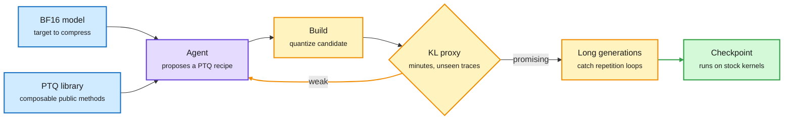

# QDA: Closed-Loop LLM Quantization Design with Agents (2611.23388)

**TL;DR.** MIT and NVIDIA hand post-training quantization (PTQ, compressing a trained model's weights and activations to fewer bits without retraining) to an LLM agent. The agent proposes a recipe, builds the quantized model, scores it, and revises the recipe over many rounds. Two tricks make the loop affordable. First, each candidate is scored in minutes by its output KL divergence from the full-precision model on held-out reasoning traces the agent never sees, and only promising ones get long generations to catch repetition loops. Second, a library of public PTQ methods is made mutually compatible and architecture-portable, so the agent can combine them without hand-porting. Across four reasoning models QDA beats the strongest public recipe by 0.9, 1.4 and 2.2 points at W4A16, W4A8 and W3A16, using 64 GPU-hours per search. On GLM-5.3-Flash (a 320B MoE) at NVFP4 W4A4 it recovers 98.3% of FP8 accuracy versus 96.9% for the best vendor checkpoint. All checkpoints run on existing serving kernels.

The agent designs the recipe; a cheap proxy grades it

KL on unseen traces replaces tens of GPU-hours of benchmark evaluation per candidate.

Blue is input, purple is the agent, amber is the build-and-grade loop, green is the shipped checkpoint.

## Key findings
- +0.9 / +1.4 / +2.2 points over the best public recipe at W4A16 / W4A8 / W3A16, averaged over four reasoning models, 64 GPU-hours per search.
- 98.3% of FP8 accuracy for GLM-5.3-Flash at NVFP4 W4A4, against 96.9% for the best vendor checkpoint.
- No custom kernels: every recipe is constrained to formats existing serving stacks already run.
- The library, evaluator and harness are promised for release.

## Relation to prior wiki pages
- **Extends** [CompressionBench (11-16)](2026-11-16-compressionbench.md), which showed agents can ship compressed models under a budget (29 of 36 submissions passed). QDA is the first result where the agent beats expert recipes rather than just passing.
- **Tension with** [the quantization noise floor (11-19)](2026-11-19-quantization-noise-floor.md): Cloudflare showed that serving-stack changes alone flip up to 0.92% of decisions. QDA's gains of 0.9 to 2.2 points are averaged accuracy; whether the smallest (W4A16) gain clears a measured floor is not shown.
- **Same loop shape as** self-improving harness work ([gated self-edits, 11-19](../agentic-systems/2026-11-19-gated-self-improving-harnesses.md)): a proposer plus a cheap, held-out grader. Here the grader (KL on unseen traces) is designed to avoid the overfitting the [Resolution Hypothesis paper](../agentic-systems/2026-11-20-resolution-hypothesis-and-gated-self-edits.md) blames for stalled agent evolution.

## Gaps
- KL as the selection signal is validated against final accuracy only on these four models; no correlation study across architectures.
- No decision-flip or noise-floor analysis.

## Sources
- [Paper](https://arxiv.org/abs/2611.23388) · raw: `raw/huggingface/2026-11-19-qda-closed-loop-llm-quantization-design-with-agents.md`
- Social: [@omarsar0](https://x.com/omarsar0/status/2123517934974955558); DAIR Academy pick (Nov 17).

Concept pages: [quantization](quantization.md) · [agent harness engineering](../agentic-systems/agent-harness-engineering.md)
