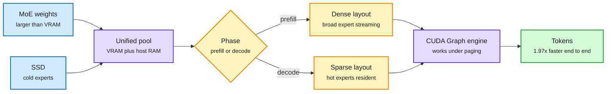

# Tideway: Phase-Aware Tiered Memory for MoE Inference on Consumer Devices (2611.14848)

**TL;DR.** Large MoE models (mixture-of-experts, where each token uses only a few expert sub-networks) do not fit in a consumer PC's GPU memory, so their weights spill across VRAM, host RAM and SSD. Existing offload systems treat each tier as a separate cache and thrash. Tideway manages host RAM and VRAM as one memory pool. It uses different memory layouts for prefill (many tokens at once, broad expert access) and decode (one token at a time, sparse expert access), and its execution engine keeps CUDA Graphs (pre-recorded GPU launch sequences that cut CPU launch overhead) working even while experts are paged in and out. On consumer hardware with frontier MoE models it averages 1.97x faster end-to-end latency, 2.40x faster time-to-first-token and 1.61x higher decode throughput than the fastest baseline. Code is open.

One pool, two layouts

Prefill and decode touch experts differently, so they get different placements.

Blue is storage, purple is the pool and engine, amber is the phase-aware placement, green is the result.

## Relation to prior wiki pages
- **Same move, smaller box:** the [memory hierarchy page](../hardware/memory-hierarchy.md) tracks datacenter versions (DeepSeek serving KV from SSD, TPU Sync spilling KV to host DRAM). Tideway brings tier-aware placement to a single PC.
- **Practitioner echo:** consumer-MoE offload has been the main LocalLLaMA theme for months (DeepSeek-V4.1-Flash at 1-bit on desktop rigs, 11-04). Tideway is the first systems paper to treat prefill and decode as separate placement problems on that hardware.
- Pairs with [batch-aware MoE routing (11-15)](2026-11-15-batch-aware-moe-routing-energy.md): both exploit the fact that which experts are hot is predictable per phase.

## Gaps
- Abstract does not name the models or hardware; SSD-heavy configurations are not broken out.

## Sources
- [Paper](https://arxiv.org/abs/2611.14848) · [Code](https://github.com/Afterglow231/Tideway) · raw: `raw/huggingface/2026-11-19-tideway-phase-aware-tiered-memory-management-for-moe-inferen.md`

Concept pages: [memory hierarchy](../hardware/memory-hierarchy.md) · [KV cache](kv-cache.md)
