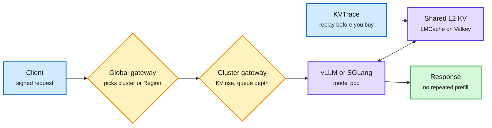

# AWS ships two serving layers: a distributed KV-cache agent skill and a cross-Region inference gateway

**Sources:** [Distributed KV caching agent skill](https://aws.amazon.com/blogs/machine-learning/cut-self-hosted-llm-cost-and-latency-with-the-distributed-kv-caching-agent-skill/) · [HyperPod Global Inference Gateway](https://aws.amazon.com/blogs/machine-learning/introducing-amazon-sagemaker-hyperpod-global-inference-gateway-one-endpoint-across-regions-and-clusters/) · raw: `raw/labs/2026-11-21-153315-labs.md`

**TL;DR.** Two AWS posts on 11-20 push KV-cache-aware serving further into managed infrastructure. **The distributed KV caching skill** is an agent skill (it runs inside Kiro, Claude Code or Codex) that decides whether a shared L2 KV cache is worth paying for, then sets it up. Self-hosted servers each keep a small local prefix cache, so a returning multi-turn conversation often pays full prefill again. The skill first checks free fixes (turn prefix caching back on; if the GPU prefix hit rate is already above 90% with session affinity, you may not need a shared cache). It then estimates savings from your own traffic with **KVTrace**, which records vLLM or SGLang KV events as block hashes and replays them offline against candidate cache sizes, recommending the smallest size that reaches 90% of the savings ceiling. Setup adds the LMCache connector to vLLM or SGLang, uses ElastiCache for Valkey 9.1 over EFA RDMA, and forces one KV ID scheme and KV data type across the fleet. Before production it checks that two cache-loaded runs give identical output, because a layout mismatch can show healthy hit counters and wrong answers. **The Global Inference Gateway** adds a second routing tier. The existing per-cluster gateway already places requests on pods using KV-cache utilization and queue depth; the new one picks the cluster, across clusters and Regions, over PrivateLink with failover.

Two routing tiers and a shared cache underneath

The global gateway picks the cluster, the cluster gateway picks the pod, and a shared KV tier saves repeated prefill.

Blue is input and the sizing tool, amber is routing, purple is serving and cache, green is the result.

## Key points
- **Cutover point:** for short prompts, loading KV state can take longer than recomputing it. The skill computes where reads win and stops if savings do not cover the cache cost.
- **Correctness check is the most useful detail:** mismatched KV hashing or dtype across servers produces cache hits with wrong outputs, a failure that dashboards do not show.
- **Routing is now two-tier and KV-aware by default** on AWS: cluster choice globally, pod choice by KV utilization locally.

## Relation to prior wiki pages
- **Continues 11-18's SageMaker KV-aware routing post** (routing requests to pods by KV-cache utilization), covered in that day's digest. AWS has now shipped the pod tier, the cluster tier and the shared-cache tier inside one week.
- **Agent-as-operator pattern:** like QDA (11-20, an agent that designs quantization recipes graded by a cheap KL check), the skill wraps an efficiency decision in an agent with a measurement gate before any spend. See [KV cache](kv-cache.md) and [LLM routing](../ai-routing/llm-routing.md).

## Gaps
- No published hit-rate or dollar savings for a real customer workload; the example fleet uses scenarios because no hit rate was given.
- Vendor post: Valkey on i8ge nodes is the only supported shared tier.

Concept pages: [KV cache](kv-cache.md) · [LLM routing](../ai-routing/llm-routing.md)
