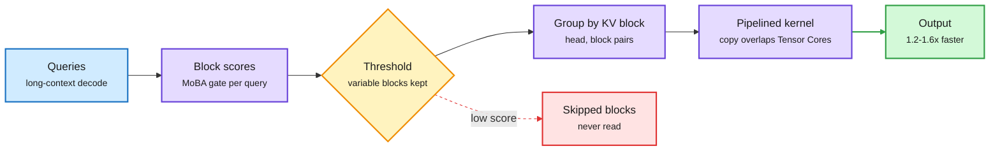

# LightningMoBA: Accelerating Mixture of Block Attention via Dynamic Routing, KV-Centric Execution and Runtime Pipelining (2611.26268)

**TL;DR.** MoBA (mixture of block attention) splits the KV cache (the stored keys and values of past tokens) into blocks and lets each query attend only to the few blocks it scores highest. FlashMoBA made that fast, but it keeps a fixed Top-k budget per query and schedules work by query range. A fixed budget wastes reads when scores are peaked and starves the query when scores are flat. Scheduling by query also means that when several query ranges pick the same KV block, each one loads it again. LightningMoBA changes three things at once. It thresholds block scores so each query keeps a variable number of blocks (dynamic routing). It groups work by the (query head, KV block) pair, so a loaded KV tile is reused by every query that chose it (KV-centric ownership), splitting very popular blocks into bounded tasks. On Hopper it overlaps the regular K/V copies and irregular query gathers with Tensor Core math (runtime pipelining). At matched Top-16 retention across five checkpoints, end-to-end generation is 1.20-1.60x faster and mean RULER rises from 74.42 to 75.28.

Schedule by the KV block, not by the query

Each selected block is loaded once and shared by every query that picked it.

Blue is input, purple is the kernel path, amber is the dynamic budget, green is the result, red is work avoided.

## Key points
- **Dynamic routing:** a per-query threshold replaces fixed Top-k and emits variable-length sparse metadata directly. Retention is decoupled from GPU tile size.
- **KV-centric ownership:** fixes the duplicate-load problem when many queries pick the same block. High-fanout blocks are split so no task is unbounded.
- **Pipelining on Hopper:** regular K/V transfers and irregular gathers overlap with compute.
- **Result:** 1.20-1.60x end-to-end at matched Top-16 retention, with a small accuracy gain (RULER 74.42 to 75.28).

## Relation to prior wiki pages
- **Confirms NVIDIA's sparse-attention guide (11-18)**, which argued that block-level selection with large blocks lets core attention fetch keys in bulk and share them across query heads ([summary](2026-11-18-nvidia-sparse-attention-indexer-codesign.md)). LightningMoBA is the first paper this month to build exactly that reuse into the scheduler.
- **Extends the dynamic-budget thread:** adaptive sparse attention like FVAttn (07-23) set budgets per head; here the budget is per query and enforced by the kernel.
- The selection step is a router over KV blocks, so this sits at the KV-cache and routing intersection tracked on the [KV cache page](kv-cache.md).

## Gaps
- Hopper only. Blackwell's larger shared memory and TMA changes could shift where the pipelining gain comes from.
- Five checkpoints, matched Top-16; behaviour at very low retention (Top-4) and at batch sizes above decode-1 is not in the abstract.

## Sources
- [Paper](https://arxiv.org/abs/2611.26268) · raw: `raw/huggingface/2026-11-20-accelerating-mixture-of-block-attention-via-dynamic-routing.md`

Concept pages: [KV cache](kv-cache.md) · [attention mechanisms](../llms-foundation-models/attention-mechanisms.md)
