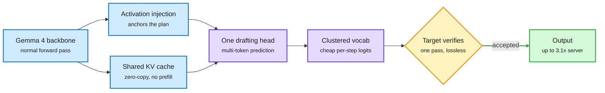

# G-MTP: Google's built-in multi-token-prediction drafter for Gemma 4 (2611.25813)

**TL;DR.** Speculative decoding needs a drafter that is cheap and still agrees with the target model. Google's G-MTP extends the Gemma 4 backbone with a single shared drafting head instead of shipping a separate small model. Three choices make it cheap. Target activation injection feeds the backbone's own hidden activations into the head, so drafts follow the backbone's plan. Zero-copy KV-cache cross-attention lets the head attend to the backbone's existing KV cache, so the drafter needs no prefill of its own and adds little memory. A clustered vocabulary projection scores vocabulary clusters instead of the full vocabulary on each draft step, which matters most on small devices where the output projection is a big share of drafter cost. Out of the box it gives up to 3.1x on large server models, up to 2.3x for small models on an H100 and up to 2.2x on a smartphone GPU. Under domain shift, distilling the drafter together with an adapted backbone needs up to 1.83x fewer target forward passes than tuning the backbone alone. Code for the adaptation recipes is public.

The drafter borrows everything the target already computed

Activations and KV cache come from the backbone, so the only new cost is one head and a cheaper vocab step.

Blue is what the backbone already has, purple the new drafter parts, amber verification, green the result.

## Key points

- **One shared head, not a separate model.** Avoids a second set of weights and a second prefill.
- **Zero-copy KV cross-attention.** The drafter reads the target's KV cache in place, so draft memory overhead is small. This is the piece that matters for on-device serving.
- **Clustered vocabulary projection.** Cuts the full-vocabulary matmul per draft step.
- **Numbers:** up to 3.1x server, 2.3x small model on H100, 2.2x on a phone GPU.
- **Domain adaptation:** co-distilling the drafter with the adapted backbone needs up to 1.83x fewer target forward passes than tuning only the backbone, so the drafter stays aligned after fine-tuning.

## Gaps

- Batch-size curves are not in the abstract; speculative speedups usually shrink at high batch.
- Compared mainly against Google's own setups. No head-to-head against DFlash, EAGLE-3 or the 11-21 NarrowSpec narrow drafters.
- No alphaxiv overview was available; built from the abstract and DAIR's curator notes.

## How it relates to prior wiki pages

- **Confirms** the drafter-conditioning pattern on [speculative-decoding](speculative-decoding.md): DNeo (11-19, drafters are limited by how they encode the target's hidden states), MMFlash (11-17, acceptance falls as tokens depend on the image) and NarrowSpec (11-21, the drafter can be a quarter of the target's width if it reads its hidden states). G-MTP is the fourth result in a week saying the drafter's value comes from what it borrows from the target, not its own capacity.
- **Extends** the MTP-in-the-model line: Soft-MTP (10-31) showed MTP training is a self-distillation term; Nemotron 3.5 boosted MTP acceptance after training. G-MTP is a frontier lab shipping the MTP drafter as part of the model family, with an on-device target.
- **KV angle:** zero-copy cross-attention on the target cache is a direct [kv-cache](kv-cache.md) reuse result.

**Source:** [arXiv 2611.25813](https://arxiv.org/abs/2611.25813) · [DAIR Academy pick (11-19)](https://academy.dair.ai/papers/efficient-and-robust-drafting-with-multi-token-prediction-2611.25813) · [@dair_ai](https://x.com/dair_ai/status/2124246507125903841). Raw: `raw/twitter/feed/2026-11-22-morning-ranked.json`.
