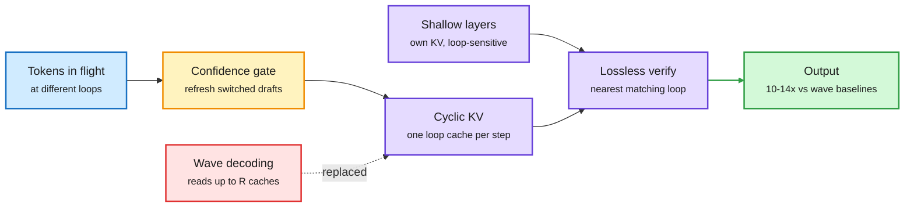

# LoopCache: self-speculative decoding that moves one loop's KV cache per step (2611.24301)

**TL;DR.** A looped Transformer reuses one weight-shared block R times per token, and every loop keeps its own KV cache (the stored attention keys and values of earlier tokens). The fastest existing way to decode these models is "wave" self-speculation (WaveFront Decoding, LoopSpec): early loops act as the drafter, later loops verify, and drafting and verifying for different tokens run in the same step. Two things go wrong. Drafts are taken only at fixed loops, so the method keeps spending compute on guesses that intermediate loops have already changed. And because one step batches tokens that sit at different loops, it reads up to R loop caches per step, which multiplies memory traffic at long context. LoopCache fixes both. It refreshes drafts at every intermediate loop when the model's confidence says the prediction switched, and it rotates through the loop caches so each step reads only one, batching tokens at the nearest matching loop for lossless verification. A few loop-sensitive shallow layers keep their own independent caches, which raises acceptance at negligible cost. Reported speedups average 10.25x over WaveFront Decoding and 14.56x over LoopSpec.

Read one loop's cache per step, not R of them

The speedup comes from changing how KV bytes move, not from a stronger model.

Blue is input, amber the draft-refresh gate, purple the cache and verify path, red the cost removed, green the result.

## Key points

- **Two inefficiencies named precisely.** Stale drafts (fixed-loop drafting ignores intermediate prediction changes) and R-fold KV traffic (cross-loop batching).
- **Confidence-guided draft updating.** Prediction switches across loops correlate with low output confidence, so the draft is refreshed in flight at any loop where that happens.
- **Cyclic loop KV cache.** Each decode step touches a single loop's cache; tokens are verified at the nearest step whose loop matches. Verification stays exact.
- **Selective independent caches** for a handful of shallow layers that are most sensitive to the loop index.
- **Speed:** 10.25x average over WaveFront Decoding, 14.56x over LoopSpec. The paper frames the target as long-context looped models.

## Gaps

- Speedups are relative to two wave baselines, not to LoopFill (11-18, exact tree speculation, 5.85x over greedy on Ouro-2.6B) or Late Entry (11-20, new tokens skip early passes, 5.2-8.4x exact). A common baseline against plain greedy decoding is needed to rank them.
- Only looped models. No numbers yet on a looped MoE such as Inkling 2 Mini, where expert weight reads compete with KV reads for bandwidth.
- No alphaxiv overview was available; this page is built from the abstract and a practitioner summary.

## How it relates to prior wiki pages

- **Extends** the looped-model latency thread on [looped-transformers](../llms-foundation-models/looped-transformers.md): LoopFill (11-18) and Late Entry (11-20) attacked sequential loop latency; LoopCache is the first of the three to name memory traffic across loop caches as the binding cost.
- **Complements** the KV-compression side: LoopVQ (11-06) codes KV jointly along the loop axis to 0.5 bits per element, and Dory (11-05) keeps only the last loop's KV. LoopCache keeps every loop's cache but reads one per step. Whether these compose is open.
- **Confirms** the "bytes, not FLOPs" pattern from the 11-21 digest (LightningMoBA loads each KV block once for all queries; NarrowSpec's gain is largest on bandwidth-bound GB10).
- Concept pages: [speculative-decoding](speculative-decoding.md), [kv-cache](kv-cache.md), [looped-transformers](../llms-foundation-models/looped-transformers.md).

**Source:** [arXiv 2611.24301](https://arxiv.org/abs/2611.24301) · surfaced on X via [@qingke_ai](https://x.com/qingke_ai/status/2123816139314913520). Raw: `raw/twitter/feed/2026-11-21-evening-*-ranked.json`.
