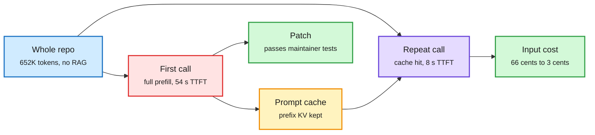

# Qwen4 Max on Together AI: a whole repository in one prompt, and what caching does to the bill

**TL;DR.** Together AI put Alibaba's Qwen4 Max (a sparse MoE, 2.4T total parameters and 71B active per token, 1M-token context, released 11-16) on its serverless API and tested it with no tools and no retrieval. It sent all 344 files of the Tornado Python web framework (652,519 tokens) plus a symptom-only bug report in one request. First token came at 54 seconds, the full reply at 72 seconds, and the patch passed the two regression tests the maintainers wrote for the real fix, plus all 1,673 tests in the suite. The model also found the precedent in `tornado/iostream.py` that the maintainers' own commit cites. The request cost 69 cents at sale prices (98 cents at list). The cost story is the caching: resending a ~630K-token prompt hit Together's automatic prompt cache, so time to first token dropped from 54 to 8 seconds and input cost from 66 cents to about 3 cents.

The second call is the cheap one

Prefill dominates a whole-repo prompt; a cached prefix removes most of both the wait and the bill.

Blue is input, red the expensive first prefill, amber the cache, purple the cached call, green the outcomes.

## Key points

- **Pricing (Together):** list $1.50 input, $4.50 output, $0.075 cached input per 1M tokens; 30% off through 11-22. Cached input is 20x cheaper than fresh input.
- **Serving constraints:** streaming-only (non-streaming returns a 400), thinking on by default, and thinking tokens bill as output.
- **Alibaba's own claims:** beats Qwen3.8 Max on its Work360 benchmark, uses 35% fewer tokens at high reasoning effort, about 60% lower cost per task. Vendor figures.
- **Scope:** one hand-picked example, chosen after the model's release date so the fix could not be in training data.

## How it relates to prior wiki pages

- **Contrasts with** Nvidia's "You Don't Need Long Context" (11-04), which argued periodic summaries and keyword search usually match full-context results at a fraction of the cost. Together's test is the opposite bet: put everything in, then let the prefix cache make repeats cheap. The two only conflict for one-shot queries; for repeated queries over the same corpus, caching changes the math.
- **Confirms** the practitioner economics on [kv-cache](kv-cache.md): Uber compacting Claude Code sessions at 400K tokens (11-21) and AWS's priced shared KV tier (11-21) both treat reuse of prefill as the cost lever.
- Earlier coverage of the model: [Qwen4 Max and Loopback Transformer (11-17)](../llms-foundation-models/2026-11-17-qwen4-max-and-loopback-transformer.md).

**Source:** [Together AI blog](https://www.together.ai/blog/qwen4-max). Raw: `raw/labs/2026-11-22-103314-labs.md`.
