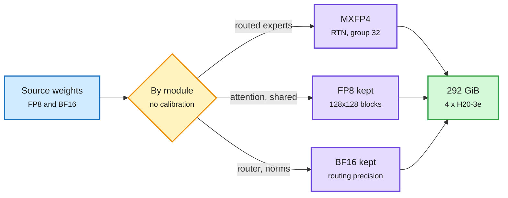

# LingSante 3.1 flash in MXFP4 with no calibration, and a diffusion model on an INT8-only car chip

**Sources:** [inclusionAI/LingSante-3.1-flash-MXFP4 model card](https://huggingface.co/inclusionAI/LingSante-3.1-flash-MXFP4) (raw: `raw/labs/2026-11-22-230140-labs.md`) · [@rohanpaul_ai on the source model](https://x.com/rohanpaul_ai/status/2124584403695435777) · Tesla Reality View posts ([architecture](https://x.com/elonmusk/status/2124458557525397780), [TRIP constraints](https://x.com/elonmusk/status/2124459444620628193)) from the X Following feed.

## TL;DR

Ant Group's inclusionAI released a 4-bit build of its open medical model LingSante 3.1 flash. It is a hybrid-linear MoE (mixture-of-experts, where each token uses only a few expert sub-networks): about 560B parameters, about 25B active, 512 routed experts with 8 active, a 7:1 mix of KDA linear-attention and gated MLA layers, and a 262K context. Only the routed-expert matrices go to MXFP4 (4-bit E2M1 values in groups of 32 sharing one 8-bit E8M0 scale). The method is plain round-to-nearest (RTN) with no calibration data and no retraining. Attention, shared experts and dense MLPs stay FP8; router, embeddings, norms and lm_head stay BF16; a few state parameters stay FP32. The checkpoint is 292 GiB, aimed at 4 H20-3e GPUs, served W4A8 or W4A16 through SGLang's Humming MoE kernels with one MTP layer for speculative decoding. Every published score is for the unquantized source model, which reportedly tops GPT-6 Astra, Opus 5.5 and Gemini 4 Argon on HealthBench Professional and EHR-Complex.

Only the experts go to 4 bits

The bulk of the bytes sit in routed experts, and each expert sees few tokens, so they are the cheapest place to lose precision.

Blue is the source checkpoint, amber the per-module rule, purple the kept precisions, green the deployable result.

## Tesla Reality View: diffusion under integer-only constraints

Musk described FSD v15's Reality View: it reuses the Universal Vision Encoder features that already feed the 3B driving model, then runs a separate roughly 1B conditional mean-flow diffusion model that predicts the next frame from the previous one, emitting 8-frame chunks at 36 fps on half of one TRIP engine across 4 cycles. TRIP handles only 8-bit integers, so softmax is emulated in 28 steps, and a small decoder moved into SRAM to free compute. Interleaving fresh encoder features into the diffusion layers should cut latency about 35%; AI5 reportedly brings about 12x more compute. Self-reported, no paper.

## Gaps

- No quantized-checkpoint benchmarks: the quality cost of data-free RTN on 512 experts is unmeasured.
- No throughput or latency numbers; the card says they depend on kernels and batch.
- Tesla figures are executive posts, not a technical report.

## How this relates to prior wiki pages

- **Extends [quantization](quantization.md):** the 11-18 update recorded the KV cache going to FP4 and shared experts following routed ones; this release does the opposite on shared experts (kept FP8), and goes data-free. QDA (11-20, an agent that searches PTQ recipes) beat expert recipes by 0.9-2.2 points; LingSante is the zero-search baseline those gains should be measured against.
- **Joins the 11-12 2.8T mixed-precision FP4 entry** as evidence that large open MoEs now ship expert-only 4-bit as the default format.
- **Distillation link:** the source model merges specialist RL models through multi-teacher on-policy distillation ([knowledge distillation](knowledge-distillation.md)).
- **Hardware link:** Tesla's 28-step softmax emulation is a concrete example of operator-level cost on integer-only accelerators ([GPU kernels](../hardware/gpu-kernels.md)).
