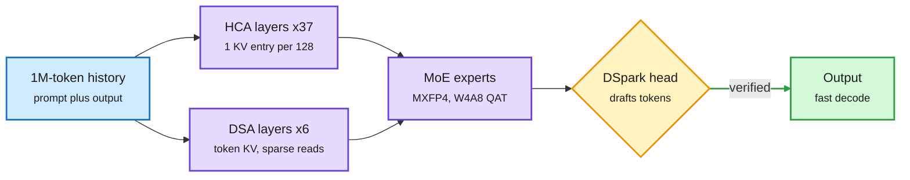

# ERNIE 5.5 Flash Preview open weights

## TL;DR

Baidu published open weights (Apache 2.0) for ERNIE 5.5 Flash Preview on 11-23, two days before the 11-25 date it had promised when the model went free on OpenRouter (11-14 digest). It is a mixture-of-experts (MoE) model: 280B total parameters, 14B active per token, 1M-token context, 43 layers, 512 routed experts with top-10 routing plus one shared expert. The card is mostly a serving-cost document. Cost is cut in three places:

1. **Attention that barely stores anything.** 37 of 43 layers use Heavily Compressed Attention (HCA), which keeps one KV cache entry per 128 tokens of history. The other 6 layers keep token-level KV but use sparse attention (DSA), so each step reads only selected positions. The KV cache is stored in FP8 and the DSA indexer runs in FP4.
2. **4-bit experts trained for 4-bit.** Routed experts (most of the parameters) are stored in MXFP4 and run as W4A8 (4-bit weights, 8-bit activations). Quantization-aware training (QAT) during post-training uses the same block granularity, scaling and rounding as inference, so the released weights deploy directly with no calibration. Everything else is blockwise FP8.
3. **A built-in drafter.** A DSpark draft head for speculative decoding (a small head guesses several tokens and the big model checks them in one pass) ships with every precision.

Three repos: default (FP8 + FP4 experts), FP8, and BF16 for hardware without FP4 kernels and for fine-tuning.

Most layers keep one memory slot per 128 tokens

The KV cache stays small because only 6 of 43 layers remember individual tokens.

Blue is the context, purple is the model, amber is the drafter, green is the output.

## Benchmarks (Baidu's own runs; competitors from official reports or Artificial Analysis)

| Benchmark | ERNIE 5.5 Flash Preview | DeepSeek-V4.1-Flash | GLM-5.3 | Claude Opus 5.5 |
|---|---|---|---|---|
| Terminal-Bench 4.0 | 46.5 | 42.3 | 41.8 | 66.4 |
| DeepSWE v1.1 | 71.2 | 77.0 | 66.9 | 74.2 |
| AutomationBench | 61.9 | 60.5 | 48.2 | 58.0 |
| MCP-Atlas | 84.6 | 77.8 | 82.4 | 84.2 |
| BrowseComp | 87.4 | 80.3 | 77.8 | 90.8 |
| HLE (no tools, text) | 46.4 | 44.0 | 42.0 | 61.4 |
| AA-LCR v1.1 (long context) | 79.0 | 82.7 | 79.7 | 84.7 |

It is competitive in its size class on agent and tool use, and well behind frontier closed models on hard reasoning (HLE) and science terminals. Baidu says it is an intermediate post-training checkpoint.

## Relation to prior wiki pages

- **Resolves** the 11-14 digest note that open weights were promised before 11-25: delivered on 11-23.
- **Confirms** the "4-bit experts, higher precision elsewhere" pattern: [LingSante MXFP4 (11-23)](2026-11-23-lingsante-mxfp4-and-int8-edge.md) shipped round-to-nearest MXFP4 experts with no calibration and no quantized benchmarks. ERNIE goes further with QAT, which is the stronger answer to the accuracy question the LingSante card left open. See [quantization.md](quantization.md).
- **Extends** [kv-cache.md](kv-cache.md): HCA is the compressed-attention family the wiki first met in DeepSeek V4's interleaved compressed attention (05-25). Here it covers 86% of layers.
- **Connects** to [DSpark (10-22)](2026-10-22-drafters-under-load-eagle4-dspark-ubtree.md): the drafter now ships inside a frontier-class open model card.

## Gaps

No KV-cache size or tokens-per-second number is published. No accuracy table comparing BF16 against the W4A8 release. Long-context quality (AA-LCR 79.0) trails DeepSeek V4.1 Flash, which is the test HCA's aggressive compression has to pass.
