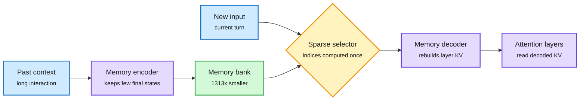

# MemOnce: a scalable memory architecture

## TL;DR

A Transformer stores keys and values for every token at every layer, so memory grows linearly with context and attention cost grows quadratically. Linear-time models (SSMs, linear attention) keep a fixed-size state but lose fine detail. MemOnce takes a third path. It stores only a small subset of **final-layer hidden states** as compact memory. When a new input arrives, a **memory decoder** turns the relevant stored states back into KV caches for every attention layer. **Memory sparse attention** picks which memories to load, and it computes those sparse indices **once** and reuses them across all layers. Adapting Qwen3.5-4B with MemOnce cut the stored memory state by **1313x** and prefill latency by **6.9x** at 1M context, raised throughput **3.5x**, and improved memory benchmarks by 5.77 points.

Keep one small state per chunk, rebuild KV only when needed

The full per-layer KV cache never sits in GPU memory; it is regenerated from a compact final-layer summary.

Blue is input, purple is the model and codec, amber is the selection step, green is what stays in memory.

## Key points

- The trade is memory for compute: decoding memories back into KV costs FLOPs at load time, but GPU memory stops growing with every layer and token.
- Works both from scratch (pretraining) and as an adaptation of an existing model (post-training on Qwen3.5-4B).
- Computing sparse indices once across layers removes the per-layer indexer cost that DSA-style sparse attention pays.

## Relation to prior wiki pages

- **Extends** [kv-cache.md](kv-cache.md): most of the page's methods compress or evict KV per layer. MemOnce stores no per-layer KV for the past at all; it stores a latent and regenerates the cache.
- **Pairs with** [ERNIE 5.5 Flash (same day)](2026-11-24-ernie-5-5-flash-open-weights.md): ERNIE compresses KV inside 37 of 43 layers; MemOnce compresses across layers. Both target the same 1M-context memory wall.
- **Relates** to [parametric-context-internalization.md](parametric-context-internalization.md): another way to keep long-lived context without holding raw KV.

## Gaps

Abstract-level evidence only (no alphaxiv overview). Results are at 4B; no frontier-scale test. Decode-time cost of the memory decoder per turn is not broken out, and "memory performance +5.77%" needs the benchmark list.
