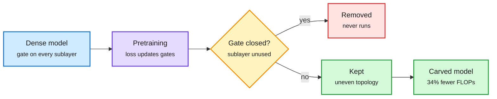

# Model Carving and efficiency shorts

## Model Carving (Harvard, NYU; 2611.27962)

Every Transformer layer normally has the same attention and MLP sublayers in the same order. Model Carving adds a learnable scalar gate to each sublayer and lets the training loss close gates it does not need. Closed sublayers are deleted, so a smaller, uneven network is "carved" out during pretraining itself. At equal training compute, carved models reached lower validation loss than dense models trained with up to **1.7x more compute**. They beat size-matched models made by pruning or by distillation, and the advantage grew with scale (140M to 2.7B standard Transformers, looped Transformers to 1.3B). Removed sublayers never run, so carved models used up to **34% fewer FLOPs per token** and decoded up to **1.6x faster** with no quality loss ([@dair_ai](https://x.com/dair_ai/status/2125027375553605836)).

The loss decides which sublayers survive

Pruning moves from after training into training.

Blue is the starting model, amber is the gate decision, red is removed, green is kept.

**Relation to prior pages.** Extends [model-pruning-sparsity.md](model-pruning-sparsity.md): the page's methods prune after training and then heal. Carving folds that into pretraining and claims to beat prune-then-distill at matched size. It was tested on looped models too, which matters for [looped-transformers.md](../llms-foundation-models/looped-transformers.md): a loop that carving thins out is cheaper per pass. Gap: largest run 2.7B; no test on MoE.

## Clover-35B-A3B-Preview (2611.24636)

A 35B-total, 3B-active MoE **diffusion** language model (it generates a block of tokens by iterative denoising instead of one at a time). It combines Gated DeltaNet recurrent memory for past context with bidirectional softmax attention inside the current block. Reported 73.6 on SWE-bench Verified, 51.7 on Terminal-Bench 2.1, and **680 tokens/s on one GB300 at BF16, batch size one**. A variant answers related questions in one denoising pass (group accuracy 65.4% to 77.0%). Vendor-reported, internal workloads.

## Serving and kernel infrastructure

- **vLLM v0.34** adds an extensible KV cache that sizes itself through the GPU's virtual memory API, which may retire the `gpu-memory-utilization` flag, plus 10 new models ([@RedHat_AI](https://x.com/RedHat_AI/status/2124871507067506820)).
- **vLLM office hours #60-61**: Tenstorrent explains running vLLM when the device runs a step ahead of the host, with four KV pools in one process; a speculators talk notes a full Markov matrix over Qwen3.8-27B's vocabulary would be 61.7B parameters, while DSpark does it with a 1.99B drafter ([@RedHat_AI](https://x.com/RedHat_AI/status/2124888067676733623)).
- **Hugging Face kernels v0.19** makes Apple Metal kernels first-class next to CUDA and ROCm ([@huggingface](https://x.com/huggingface/status/2124915755968090222)).
- **GPU MODE talk**: recent FlashInfer work on larger fusions and consistent RL numerics on Blackwell and Rubin ([video](https://youtube.com/watch?v=jhBF3UaPD2E)).

## OmniEVIE-4B (Tencent)

A 4.5B multimodal multi-vector retriever that compresses each record to at most 128 vectors of 64 dimensions in int8 (at most 9,472 bytes; 8.82 GiB per 1M records) and searches 1M records in **54.2 ms on one CPU thread** through a three-stage funnel. Hits point back to a page region or video timestamp ([model card](https://huggingface.co/tencent/OmniEVIE-4B)).
