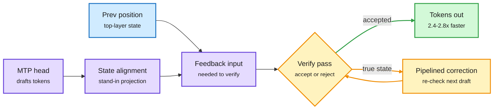

# Feedback Shortcut and DFlash2

## TL;DR

**Feedback Shortcut** ([2611.28227](https://arxiv.org/abs/2611.28227)). A latent feedback Transformer feeds each position's top-layer hidden state back into the next position's input. That helps quality, but it breaks speculative decoding: to verify a drafted token you need the top-layer state of the position before it, which you do not have yet. Prior work used an approximate stand-in, which lowered the quality ceiling. Feedback Shortcut does two things. **State alignment** trains a small projection from the multi-token-prediction head's states to the stand-in, without touching base training. **Pipelined correction** re-checks each draft using its predecessor's freshly computed true state, and does it inside the next verification pass, so it costs zero extra calls. At 135M and 780M it stays within 1e-4 bits per byte of exact decoding on Paloma and decodes 2.4 to 2.8x faster, for about 2% more training compute. At large batch, skipping correction keeps plain-Transformer speed and over 80% of the feedback gain.

**DFlash2 drafters (Red Hat AI).** Two production drafters shipped this window:
- [Qwen3.8-27B-speculator.dflash2](https://huggingface.co/RedHatAI/Qwen3.8-27B-speculator.dflash2): a 5-layer draft attached to target layers 5, 19, 33, 47 and 61, trained with Muon and position-weighted loss. Up to 7 draft tokens per step, 4.5 mean accepted on HumanEval and 6.0 on math. Up to 2.76x output throughput on summarization and 2.68x on RAG (SPEED-Bench). Ready for vLLM.
- [Muse-Spark-Open-816B-A42B-speculator.dflash2](https://huggingface.co/RedHatAI/Muse-Spark-Open-816B-A42B-speculator.dflash2), with Inferact: a BF16 5-layer drafter for Meta's NVFP4 Muse Spark Open, reading target layers 42 to 58, 7 tokens per step. Over 3x throughput on SPEED-Bench coding, math and RAG on the same 4x B200 node. The card includes long-context acceptance out to 1M tokens.

Verify with the true state you just computed, for free

Feedback Shortcut folds the correction into the next verification pass instead of adding a call.

Blue is the feedback signal, purple is drafting, amber is verification and correction, green is accepted output.

## Relation to prior wiki pages

- **Fifth result in eight days** on [speculative-decoding.md](speculative-decoding.md) saying the drafter's value comes from what it borrows from the target: DNeo (11-19, better encoding of target hidden states), NarrowSpec (11-21, a thinner drafter keeps acceptance), G-MTP (11-22, drafter reads the target's KV cache), LoopCache (11-22). Feedback Shortcut is the case where the target's state is not yet available, and it borrows the next-best one.
- **Extends the looped-model decoding thread** (LoopFill 11-18, Late Entry 11-20, LoopCache 11-22): latent feedback is recurrence across positions rather than across depth, and it hits the same "verification needs a state you have not computed" wall.
- **Partly answers** the 11-22 Looking Ahead bet that built-in MTP drafters would displace separate drafters. DFlash2 for Muse Spark Open says separate drafters still win the biggest open model on the market, at over 3x.
- **Prior DFlash2 context:** [Muse Spark Open and Nemotron 3.5 (10-16)](../llms-foundation-models/2026-10-16-muse-spark-open-and-nemotron-35.md).

## Gaps

- Feedback Shortcut is tested only at 135M and 780M.
- DFlash2 numbers are vendor numbers; batch sizes are not stated in the posts, and speculative gains usually shrink at high batch.
