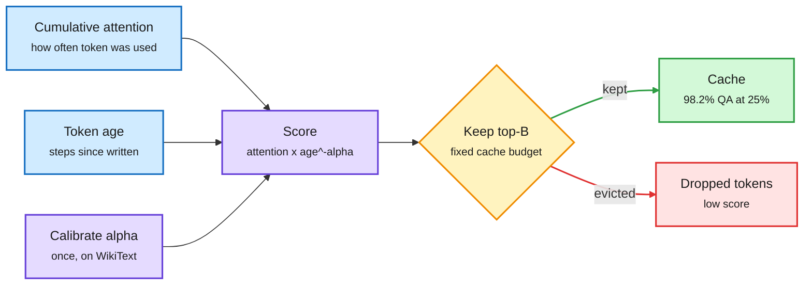

# NoHairCache: calibrate-once KV cache eviction with one power-law exponent

## TL;DR

KV cache eviction decides which past tokens to drop when the cache is full. Two baselines dominate: **H2O** keeps tokens that have collected the most attention, and **StreamingLLM** keeps the most recent tokens plus a few "attention sink" tokens at the start. NoHairCache shows they are one family. Score each token as `s_i = A_i * (t - i)^(-alpha)`, where `A_i` is the token's cumulative attention and `(t - i)` is its age. With `alpha = 0` you get H2O (age does not matter). As `alpha` goes to infinity you get a pure recency window, which is StreamingLLM without its hard-coded sink patch. The paper's claim is that **alpha is a property of the model, not the dataset**: calibrate it once on WikiText and it transfers. For Qwen2.5-1.5B-Instruct the admissible range is about 0.56 to 0.82. With one alpha per model, NoHairCache gets the lowest perplexity on WikiText, PG19 and arXiv (0.06 to 0.10 PPL better than StreamingLLM at a 512-token budget, p < 0.05) and keeps 98.2% of full-cache NarrativeQA accuracy at 25% retention versus 91.1% for StreamingLLM. The QA gains are not statistically significant per cell, which the authors say plainly.

One knob slides between "keep the popular" and "keep the recent"

The age exponent alpha is fitted once per model and reused on every dataset.

Blue are the two signals, purple is the scoring rule, amber is the budget cut, green is kept, red is evicted.

## Key points

- The unification is the contribution. It turns "which eviction policy?" into "what is this model's age exponent?", one number instead of a policy zoo.
- Alpha's admissible range comes from a theoretical "no-hair" bound in prior work by the same group, and the measured ranges match the perplexity-optimal regions on five models (410M to 1.5B).
- Calibration is cheap: one corpus, one sweep, then a drop-in scorer. Code and the scorer are promised on publication.
- Scale is small. Nothing above 1.5B, and no agent or multi-turn traces.

## Relation to prior wiki pages

- **Confirms and complements** [Eviction as Estimation (08-03)](2026-08-03-eviction-as-estimation-rmm.md), which put StreamingLLM, H2O and SnapKV on one "commit lag" axis and found that on natural text the choice of eviction policy is close to free. NoHairCache puts the same two baselines on a second axis (age penalty). Its small perplexity gains (0.06 to 0.10) and non-significant QA gains are what RMM's diagnosis predicts for natural-text benchmarks. The two axes are orthogonal: a smoothed commit (RMM) with a power-law age score (NoHairCache) has not been tried.
- **Contrasts with** [Conf-KV (05-30)](2026-05-30-conf-kv-confidence-aware-eviction.md) and Make Each Token Count (05-12), which make the budget or retention learned and per-step. NoHairCache goes the other way: a single fixed per-model constant.
- **Fits** [kv-cache.md](kv-cache.md)'s 2026-11 thread that architecture (ERNIE 5.5 Flash's 1-in-128 compression, MemOnce's decoded memory) is doing more than eviction policy. NoHairCache is a useful default for runtimes that cannot change the architecture.

## Open questions

- Does alpha stay a model constant at 30B+ and on agent traces, where reuse depends on the model's own earlier output?
- Does alpha differ per layer or per head? A per-head alpha would connect to head-role pruning results.
