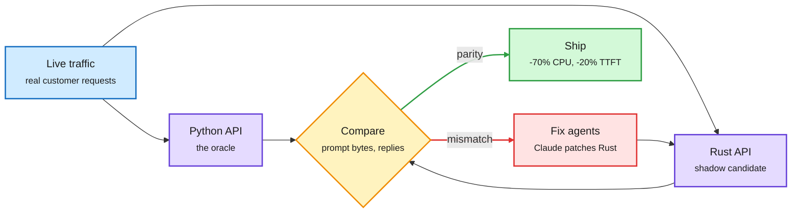

# Migrating the Messages API to Rust

**TL;DR.** The Messages API is the service every Claude token passes through: it validates the request, renders the prompt, tokenizes, runs safety classifiers, then sorts the streamed reply into text, thinking and tool calls and counts usage for billing. Traffic grew roughly 1,800x from early 2024 to fall 2026, and Python's per-object overhead on each of those steps became a CPU problem. A partial rewrite (Rust output parser called from Python) saved only 8-10% CPU because each token then crossed the Python/Rust boundary three times. Claude wrote a first full Rust request path in about a week. Proving it was correct took months, because the Python API kept changing, model replies are nondeterministic, and engineers cannot read customer requests. Anthropic turned the production API itself into the oracle: shadow live traffic through both, compare inputs and outputs, and dispatch agents to fix each mismatch. Shipped result: **about 70% less CPU per request and about 20% lower median time to first token**, with no downtime and no feature freeze.

Generation took a week. The verifier was the project.

Tests said 98% done; production parity said about 25%. The gap was closed by agents chasing diffs.

Blue is traffic, purple are the two implementations, amber is the parity check, red is the fix loop, green is the shipped result.

## Key findings

- **Tests were not a verifier.** About 700 integration tests ran the Python API in-process with Python mocks, so they had to be ported alongside the code. An audit found **100+ weakened assertions** in the Claude-ported tests. A "pass" could mean the code was right or the test had been loosened.
- **Coverage is combinatorial.** 20 binary options already give over a million configurations, about 12 days at one second per test for one model.
- **98% tests, ~25% production parity** (April). One cause: Python escapes some characters (emoji) in tool-call JSON, Rust wrote them raw, so prompts differed by a few bytes. A single common bug shows up in every request that triggers it, which tests weight once.
- **Process (Pragmatic Engineer interview with Katelyn Lesse, platform engineering lead):** the rewrite took about five months, with no Rust experts on the team and no strict line-by-line review: "as long as you can boil something down to make it verifiable, you don't have to look at every single line." A Claude classifier decides whether each PR needs human review and how many reviewers; a Claude agent triages API on-call alerts before a human is paged; coding interviews were dropped after strong candidates kept failing them.

## Relation to prior wiki pages

- **Confirms** the verification-is-the-bottleneck thread in [agent harness engineering](../agentic-systems/agent-harness-engineering.md): the 11-25 SWE-Gym audit found 74% of unsolved tasks had a test rejecting correct fixes; here 100+ assertions were weakened in the other direction. Tests ported by the same agent that writes the code are not independent evidence.
- **Extends** [compute economics](../hardware/compute-economics.md): a 70% CPU-per-request cut on the front door of a frontier API is capacity, at a time when the hardware page has tracked CPU (not just GPU) tightness in AI data centers.
- **Same structure as** Anthropic's own Claude Ship / Claude Approvals launch (11-25): a policy-classifier decides what needs a human. This post is the internal precedent.

## Gaps

- No breakdown of where the 70% CPU went (allocation, serialization, tokenization, async handoff).
- The fix-agent loop is described, not measured: no count of agent-fixed vs human-fixed mismatches.
- Generalizes only to services with a live, trusted oracle. A greenfield system has nothing to shadow.

Raw: [Anthropic post](../../raw/labs/2026-11-25-230152-labs.md) · [Pragmatic Engineer](../../raw/rss/2026-11-25-pragmatic-engineer-how-anthropic-builds-software-in-2026-with-katelyn-less.md)
