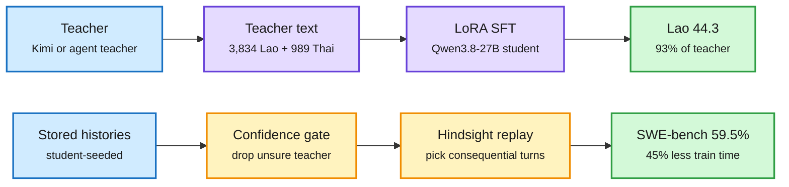

# Distillation two ways

**TL;DR.** Two distillation results from opposite ends of the cost scale. Together AI distilled Kimi-K3.1-Pro's Lao translation into Qwen3.8-27B with a LoRA for $260 total, reaching 93% of the teacher, and found the real risk is forgetting the neighbouring language. CARE-OPD makes on-policy distillation (the student generates, the teacher grades each token) affordable for long-horizon agents by replaying stored histories smartly, cutting training time 45% on SWE-bench Verified.

Off-policy for tokenizer mismatch, replay for long horizons

Together uses teacher text only; CARE-OPD reuses stored trajectories but picks which turns to train on.

Blue is the teacher or stored data, purple is training, amber is the selection step, green is the result.

## Together AI: Kimi-K3.1-Pro into Qwen3.8-27B (Lao)

- **The gap.** Qwen3.8-27B answers in Thai when asked for Lao: 5.5 chrF++ (a 0-100 character/word overlap score) on FLORES-200 Lao, only 11% Lao script. Kimi-K3.1-Pro scores 47.5.
- **Why off-policy.** On-policy distillation needs the teacher's log-probabilities on student tokens, so both must share a tokenizer. Kimi and Qwen do not, so the teacher writes translations and the student imitates them with supervised fine-tuning.
- **The failure mode.** Training on 945 human Lao references alone lifted Lao to 43.3 in 25 steps but collapsed Thai from 46.7 to 5.3. The model learned "write Lao when translating", not "write the language asked for". Distilled Lao alone slowed the damage but Thai still slipped by epoch 3.
- **The fix.** Mixing about 1,000 Kimi Thai translations kept Thai at 47.4-47.8, above the base model. Adding Kimi translations of 3,000 Wikipedia sentences (965 to 3,834 Lao rows) raised Lao from 41.9 to 44.3, 93% of the teacher and 92% of the base-to-teacher gap.
- **Data beats epochs.** One epoch of 4x data reached 43.2; three epochs of the small set reached 41.3.
- **Cost.** All experiments together cost $260.

## CARE-OPD (2611.34756)

- **Problem.** Fully online on-policy distillation for agents needs fresh environment rollouts per update, and long-tail rollouts leave GPUs idle. Prefix replay (sample the current student from stored histories) is cheaper but has two holes: teacher-only histories miss the states the student actually reaches, and fixed position schedules miss critical decisions deep in a trajectory.
- **Fix.** Student-seeded teacher completions broaden coverage. Response-level confidence gating drops updates where the teacher is unreliable. Hindsight replay uses downstream execution evidence to pick which turns to train on.
- **Result.** On SWE-bench Verified, 59.5% task success with 45% less end-to-end training time and 44% fewer environment actions than asynchronous online OPD. Also tested on Deep Research.

## How it relates to prior wiki pages

- **Confirms** the [11-04 order-only OPD page](2026-11-04-order-only-on-policy-distillation.md) and StepX (11-08): most distillation signal sits in a minority of positions. CARE-OPD's hindsight replay is the agent-trajectory version of that selectivity.
- **Extends** the 11-19 finding that agentic OPD from an ALFWorld teacher crashed tau-squared-bench from 41.5% to 6.6%: Together's Thai collapse is the same off-target drift in miniature, and the fix (mix in protected-capability data) matches SAFE-DRIFT on the Kurate cs.LG list this week (2611.28560, data selection with controllable off-target drift).
- **Cost frame.** $260 for a targeted capability is the cheapest concrete distillation number the wiki has. It argues for "rent the big model's text, own a small adapter" as a default when the gap is narrow.

## Gaps

Together: one language pair, chrF++ only, no human eval. CARE-OPD: teacher identity and compute per update not stated in the abstract.

Related: [knowledge-distillation](knowledge-distillation.md) · [agent-training-environments](../agentic-systems/agent-training-environments.md)
