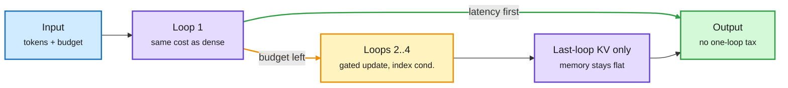

# Elastic Latent Recurrence: a looped model with no one-loop tax

**Source:** HuggingFace Daily Papers, 2026-10-12 · [arXiv 2610.12582](https://arxiv.org/abs/2610.12582) · raw: `raw/huggingface/2026-10-12-one-model-to-loop-them-all-elastic-latent-recurrence-for-lan.md`

## TL;DR

A looped (latent recurrent) language model reuses one block of layers several times, so a single checkpoint can trade inference compute for accuracy by changing the loop count. The catch so far: at one loop these models score well below a normal model of the same size (the "one-loop tax"), so whenever latency matters you would ship the normal model instead. ELR removes the tax with three choices: a gated state update with a learned step size, mixing loop counts inside each optimizer update, and conditioning each pass on its loop index and budget. Mixed depths can be switched on late in pretraining. At inference, keeping **only the last loop's attention KV cache** holds KV memory at the one-loop level while keeping most of the multi-loop gain. In MoE models, reusing the first loop's expert routes on later loops cuts mixed-depth update time 11.7% with no accuracy change. On a 4B dense and a 30B-A3B MoE hybrid, one loop lands -0.52 / +1.04 points vs matched baselines, and four loops add +7.25 / +4.75. The post-trained checkpoint is Koi-4B.

One checkpoint, a dial for compute

Loop 1 costs the same as a normal model; extra loops add accuracy without growing the KV cache.

Blue is input, purple is compute and cache, amber is the optional extra loops, green is the answer.

## Relation to prior wiki pages

- **Resolves the 10-08 practical rule** on the [looped-transformers page](looped-transformers.md) ("budget a looped model at ~2x KV and ~75% token efficiency", from Nanbeige4.2's two-pass loop): ELR keeps KV flat and removes the one-loop penalty. If it reproduces, the cost argument against looped models largely disappears.
- **Composes with** [Looped Models Done Right II (10-07)](2026-10-07-looped-fixed-points-alodlm-lift.md), which got a 3x smaller cache from terminal KV sharing at fixed points; ELR's last-loop-only KV is the same idea without the fixed-point training.
- **Routing link:** the loop count is a per-request compute knob, so a router could choose loops the way it chooses models. That turns model routing into depth routing inside one checkpoint.

## Gaps

Two scales only. "Estimated" headline score for Koi-4B. No serving-latency numbers per loop under batching.

## Related

[looped-transformers](looped-transformers.md) · [test-time-compute-allocation](../inference-efficiency/test-time-compute-allocation.md) · [llm-routing](../ai-routing/llm-routing.md)
