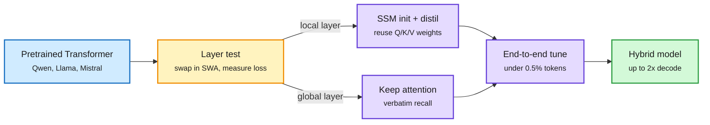

# Priming: convert a pretrained Transformer into a hybrid SSM for <1% of the cost

**Source:** Amazon Science blog (lab watcher), 2026-10-12, Luca Zancato et al., paper "Priming: Hybrid state space models from pre-trained Transformers" · [Blog](https://www.amazon.science/blog/can-we-change-an-ai-models-architecture-without-retraining-it-from-scratch) · raw: `raw/labs/2026-10-13-000834-labs.md`

## TL;DR

Hybrid models keep a few attention layers ("eidetic" memory, verbatim recall, growing KV cache) and replace the rest with SSM layers ("fading" memory, fixed-size state). Testing which hybrid works best has meant pretraining each one from scratch. Priming reuses a pretrained Transformer instead. It (1) finds the attention layers that mostly work locally, using a cheap proxy (swap the layer for sliding-window attention and measure the damage), (2) initializes an SSM in each such layer from that layer's Q/K/V projections and distils it to mimic the layer, and (3) fine-tunes the whole hybrid end to end. Total cost: under 0.5% of the source model's pretraining tokens, across Qwen, Llama and Mistral, dense and MoE, 8B to 32B+. A 32B Gated KalmaNet hybrid matches its source on reasoning and decodes up to 2x faster at 128K, reaching correct AIME answers in about two-thirds the wall-clock time. A model zoo, kernels and a vLLM plugin are released under Apache 2.0.

Keep the knowledge, swap the memory

Only layers that pass the sliding-window test become SSMs; global-recall layers stay attention.

Blue is the source model, amber is the layer-selection test, purple is conversion and training, green is the shipped hybrid.

## Key findings

- **Why it works:** attention and SSM layers both multiply the value sequence by a "mixing matrix". If a fixed-size state can approximate a layer's mixing matrix (formally, low Hankel rank), the Transformer's projections transfer directly. Local layers have low Hankel rank; long-range retrieval layers do not.
- **Controlled SSM comparison** (same data, budget, hybrid ratio): Gated KalmaNet > Gated DeltaNet > Mamba-2. GKA also allows variable-length inference compute without retraining.
- **"A good lossy summary of everything beats a perfect recording of the recent past":** SSM layers beat sliding-window attention even when SWA gets twice the memory.

## Relation to prior wiki pages

- **Pairs with [ReplaySSM (10-13)](../inference-efficiency/2026-10-13-replayssm-cache-inputs-not-state.md)** the same day: Priming makes hybrids cheap to *build*, ReplaySSM makes their SSM layers cheap to *serve*. Together they remove the two main reasons not to ship a hybrid.
- **Continues the October hybrid-mechanics thread**: [RLT/CMM (10-09)](2026-10-09-hybrid-mechanics-rlt-cmm.md) and STEPQuant (10-09) on quantizing recurrent state. Priming adds a principled test (Hankel rank / SWA proxy) for *which* layers should be recurrent at all.
- **Echoes** the 06-17 rethinking-efficient-attention page, which argued hybrids win on serving cost but lose on recall; Priming quantifies where the recall boundary sits per layer.

## Gaps

Vendor blog; the controlled SSM ranking is on Amazon's own recipe. Long-context retrieval benchmarks beyond reasoning are not in the blog summary. "Up to 2x" is at 128K; short-context gains are smaller.

## Related

[attention-mechanisms](attention-mechanisms.md) · [kv-cache](../inference-efficiency/kv-cache.md) · [knowledge-distillation](../inference-efficiency/knowledge-distillation.md)
