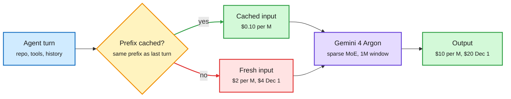

# Gemini 4 Argon: Google's frontier model, priced for cached agent loops

**Date:** 2026-10-14 · **Source:** Google DeepMind model card + Google launch post + Google Developers case study + AI Breakfast + Simon Willison · **Raw:** [labs 10-13 23:02](../../raw/labs/2026-10-13-230220-labs.md), [labs 10-14 12:29](../../raw/labs/2026-10-14-122928-labs.md), [Gmail newsletters](../../raw/gmail/2026-10-14-newsletters.md) (private)

## TL;DR

Gemini 4 Argon is Google DeepMind's new frontier model, generally available on 2026-10-13 after a cyber-defenders-only preview (the Fairwind Program) since 09-30. The model card describes a large sparse mixture-of-experts transformer (MoE: each token runs through a small subset of expert sub-networks), natively multimodal, trained from scratch on TPUs with JAX and Pathways, with a combined 1M-token input+output window and a March 2026 knowledge cutoff. Google's own table puts it first on the Vals Index (68.9% vs 67.0% Opus 5.5) and ahead on DeepSWE v1.1 (77.9% vs 74.2%), long-context GraphWalks 256K-1M (84.2% vs 66.8%) and Harvey's legal agent benchmark (19.6% vs 3.8%), but behind Opus 5.5 on Terminal-Bench 4.0 (57.4% vs 66.4%) and behind GPT-6 Astra on FrontierSWE v2 (55.0% vs 65.5%). The price is the story for this wiki: $2/$10 per million input/output tokens until 2026-11-30, cached input 95% off ($0.10/M), then $4/$20 from 2026-12-01.

Argon is priced so that rereading is almost free

For an agent loop that resends the same repo every turn, the cached-input line is the one that sets the bill.

Blue is the agent's request, amber is the cache check, green is the cheap path, red is the expensive path, purple is the model.

## Key facts

- **Availability:** Gemini API, AI Studio, Antigravity (Ultra), Gemini app and AI Mode (Pro/Ultra), GitHub Copilot GA, Gemini Enterprise. Fairwind cyber-defender program expands to hundreds more partners.
- **Model card benchmarks (Argon / GPT-6 Astra / Fable 5.1 / Opus 5.5):** Vals Index 68.9 / 63.1 / 65.8 / 67.0; AutomationBench 51.3 / 41.4 / 31.4 / 42.5; DeepSWE v1.1 77.9 / 74.1 / 67.4 / 74.2; FrontierSWE v2 55.0 / 65.5 / 56.3 / 62.3; Terminal-Bench 4.0 57.4 / 58.2 / 57.9 / 66.4; PostTrainBench 45.3 / 44.3 / 40.2 / 49.3; GraphWalks 256K-1M 84.2 / 71.8 / 65.0 / 66.8; CWE-bench 68.0 / 68.0 / 58.0 / 67.0.
- **Independent reads split:** Vals puts it first; The Decoder says it trails Opus 5.5 and Meta's Muse Wonder Full on independent indices; Agent Arena places it 5th.
- **Internal use claims (self-reported):** 100K+ Google employees monthly; agentic code submissions +35%, rollbacks down about a third over four weeks; a Chromium refactor of a ~6M-line legacy folder; Gemma 4 E2B on A100 via vLLM sped up 2.85x end to end (~37,900 to 108,000+ tok/s) with token parity, as upstream PRs.
- **ADK overnight run (the honest case study):** 11 unattended hours on google/adk-python (205K lines, ~800 files, ~17K tests). Six optimizations proposed, two shipped (in-memory session prep ~40% faster in long sessions, cold imports 21% faster), four rejected in human review.
- **Safety:** the model card says the full Safety & Security report follows separately; testing under the Frontier Safety Framework, human and automated red teaming. AI Breakfast reports a 0.7% attack success rate on Gray Swan's indirect prompt-injection suite over 15 adaptive attempts.

## How it relates to prior wiki pages

- **Confirms the cache-pricing thread.** The 10-13 IBM agent-factory result (below, via [compute economics](../hardware/compute-economics.md)) and this launch point the same way: for agent loops, the cached-input price and the prefix hit rate matter more than the list price. A 95% cache discount is the steepest the wiki has recorded from a frontier lab.
- **Extends the frontier-crowding pattern** from [Meta Muse Wonder (10-13)](2026-10-13-meta-muse-wonder.md): two frontier launches in two days, each winning on its own chosen benchmarks and losing Terminal-Bench to Opus 5.5.
- **Model card is architecture-light**, like Muse Wonder's: "large sparse MoE" with no expert count, active parameters or attention design.

## Open questions

- Does the 95% cache discount survive the 12-01 price doubling, and what hit rate do real agent harnesses get on it?
- The 2.85x Gemma speedup PRs are public. Do they hold on H100/B200, or are they A100-specific tuning?

## Related

[looped-transformers.md](looped-transformers.md) · [compute economics](../hardware/compute-economics.md) · [LLM routing](../ai-routing/llm-routing.md)
