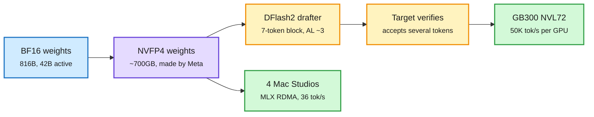

# Muse Spark Open and Nemotron 3.5: open models now ship with their serving stack

**Date:** 2026-10-16 · **Source:** AI lab watcher (NVIDIA Developer, AWS ML, Apple ML Research, HF nvidia), The Decoder, X following feed
**Links:** [NVIDIA tech blog on Muse Spark Open](https://developer.nvidia.com/blog/) via [nvda.ws/4B8d9g4](https://nvda.ws/4B8d9g4) · [Apple MLX + RDMA post](https://machinelearning.apple.com/research/mlx-distributed-inference) · [AWS JumpStart](https://aws.amazon.com/blogs/machine-learning/metas-muse-spark-open-now-available-in-amazon-sagemaker-jumpstart/) · [NVFP4 weights](https://huggingface.co/meta-models/Muse-Spark-Open-816B-A42B-NVFP4) · [DFlash2 drafter](https://huggingface.co/nvidia/Muse-Spark-Open-816B-A42B-DFlash2) · [The Decoder](https://the-decoder.com/muse-spark-open-is-metas-answer-to-qwen-glm-and-kimi-in-the-open-weight-race/) · [Nemotron 3.5 blog](https://blogs.nvidia.com/blog/nemotron-3-5-super-vl)
**Raw:** `raw/labs/2026-10-16-113107-labs.md`, `raw/rss/2026-10-15-the-decoder-muse-spark-open-is-meta-s-answer-to-qwen-glm-and-kimi-i.md`, `raw/rss/2026-10-15-the-decoder-nvidia-s-nemotron-3-5-super-vl-is-an-open-model-built-t.md`

## TL;DR

Meta released **Muse Spark Open**, an **816B mixture-of-experts with 42B active** (62 layers, 256 experts each, top-8 routing), a **1M-token context**, and native text, image, document, audio and video input through a 1.8B perception encoder. It shares a base with the closed Muse Spark 1.3, with extra safety post-training so it can run without system guardrails. This reverses Meta's April move to a closed frontier model. Benchmarks: roughly on par with the top Chinese open models; it tops MCP-Atlas tool use at 89.2, Artificial Analysis index 39, but in Meta's own chart Kimi K3 and GLM 5.3 still beat it on coding. License: free commercial use with a "Built with Muse Spark Open" label and a separate deal for API sellers above $20M revenue.

What makes it a cost story is the day-0 serving stack:
- **NVFP4 checkpoints made by Meta.** 4-bit weights need ~700GB. NVIDIA reports up to **50K tokens/s per GPU and 600 tokens/s per user** on GB300 NVL72 with speculative decoding.
- **DFlash2 speculative drafter (NVIDIA).** Drafts a 7-token block in one non-causal pass, a pairwise path selector picks among top-k candidates per position, the target verifies. Mean acceptance length **3.73 greedy / 3.01 at temperature 1** on MT-Bench; **3.30 / 2.78 on 32K-token inputs**, and as low as 2.16 on high-entropy prompts.
- **Apple MLX + RDMA over Thunderbolt.** Four M5 Ultra Mac Studios with tensor parallelism generate **over 36 tokens/s** at 8K context. M5 Ultra's Neural Accelerators cut time-to-first-token up to 4.6x vs M3 Ultra; decode is 1.6x faster from 1.2 TB/s vs 819 GB/s bandwidth. A 3-bit community quant ran in ~344GB at ~21 tokens/s on one 512GB M3 Ultra.
- Day-0 vLLM (NVIDIA, AMD, TPU), TokenSpeed (190 tokens/s per user on B300 without speculation), SageMaker JumpStart (BF16 and NVFP4), NIM.

**Nemotron 3.5 (NVIDIA, same day):** Super VL is a 120B-A12B multimodal MoE for always-on agents with NVFP4 via quantization-aware distillation, multi-token prediction and speculative decoding; NVIDIA claims up to 5x agentic throughput of same-size open models. **Bolt 74B-A9B fits in 24GB** for local agents on RTX; Bolt E4B (4GB) ships Oct 23. Red Hat posted same-day FP8 and DSpark-drafter checkpoints and reports the two stack orthogonally for close to 2x on Hopper.

The release is now a bundle: weights, 4-bit weights, a drafter, and recipes

Each layer cuts cost per token independently, and they multiply.

Blue is the base release, purple is the compressed weights, amber is the speculative loop, green is where it runs.

## Relation to prior wiki pages

- **Pattern (n=4 in two days): open releases ship with their own serving stack.** Step-5-Preview NVFP4 (10-14/15), Nemotron 3.5 Super VL with QAD-NVFP4 + MTP (10-15), Red Hat FP8 + DSpark (10-15), Muse Spark Open with Meta-made NVFP4 + DFlash2 (10-16). See [speculative decoding](../inference-efficiency/speculative-decoding.md) and [quantization](../inference-efficiency/quantization.md).
- **Acceptance length drops on long and high-entropy inputs** (3.73 to 3.30 at 32K, 2.16 high-entropy). This matches the wiki's long-running observation that speculative gains shrink exactly where agents spend their tokens.
- **Muse Wonder (10-14/15)** landed at #12 in Agent Arena at $1.13/task; Muse Spark Open is the open sibling.
- **Local frontier inference:** the 10-15 Media Zone compared an RTX 5090 to an M5 Ultra; Apple's post is the first-party benchmark for a near-1T model on desk hardware.

## Gaps

All throughput figures are vendor numbers with no batch size for the 50K/s claim. No independent coding eval yet; Arena scores pending. The 4-Mac setup cost (~$38K for 4x256GB) vs one H200 node per-token is not computed by anyone.
