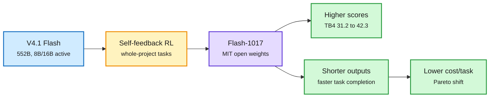

# DeepSeek-V4.1-Flash-1017: a "minor update" that moves the cost frontier

**TL;DR.** DeepSeek released V4.1-Flash-1017 on 2026-10-17 as open weights under MIT, labelled a minor update to [V4.1 Flash (09-10)](2026-09-10-deepseek-v41-flash-architecture.md) (552B total, 8B active reading input and 16B active writing output, a compressed global KV cache of about 890 bytes per token). Same architecture, new post-training: reinforcement learning with self-feedback on end-to-end project building. The headline is not one benchmark. It is that the model scores higher **and** finishes tasks faster with shorter outputs, which DeepSeek calls a Pareto improvement in performance and cost. It also opened its in-house Search and Fetch APIs at $0.75 per 1,000 calls.

Same weights budget, fewer tokens per finished task

The architecture did not change. Post-training cut output length, which is where agent cost lives.

Blue is the base model, amber is the training change, purple is the release, green is the result.

## Headline numbers (DeepSeek's table)

| Benchmark | 1017 | V4.1 Flash | GPT-5.6 Sol | Opus 5 |
|---|---|---|---|---|
| Terminal-Bench 4.0 | 42.3 | 31.2 | 39.9 | 51.8 |
| DeepSWE v1.1 | 77.0 | 74.2 | 73.0 | 74.0 |
| ProgramBench | 29.1 | 20.3 | 23.0 | 37.0 |
| Automation-Bench | 60.5 | 54.8 | 45.8 | 50.3 |
| Apex Bench v1.1 | 72.1 | 64.6 | 54.3 | 65.8 |
| HLE (no tools) | 42.6 | 36.8 | 44.5 | 56.3 |

Terminal-Bench uses the Claude Code harness; DeepSWE uses Mini-SWE-V2. Context 1M tokens, recommended max_tokens ≥256K. No Jinja chat template: a Python reference encoder plus a Rust `deepseek-recipe` library handle prompt formatting.

## Why it matters

- **Token optimization as a release axis.** Thom Wolf's read on X: shorter outputs are "one of the practical ways the cost curve collapses, often done as an afterthought." DeepSeek plots DeepSWE pass@1 against cost per task, not against parameters.
- **Harness-tuned.** Optimized for DeepSeek Harness v0.2.1+, Tencent CodeBuddy and WorkBuddy. Benchmarks are reported per harness, matching the wiki's thread that the harness moves cost as much as the model ([HarnessRouter, 10-17](../ai-routing/llm-routing.md)).
- **Interconnects (10-17) places V4.1 Flash near Meta's Muse Spark Open** on capability. 1017 lands two days after Muse Spark Open, widening the gap Meta had just narrowed.
- **Search and Fetch at $0.75 per 1,000 calls**, free inside DeepSeek Harness, Claude Code and Codex until 2026-10-31. A lab bundling its own retrieval with cheap tokens.

## Gaps

All numbers are DeepSeek's own. No output-length or cost-per-task figure is given in text, only a chart. The tech report title ("Pushing the Limits of KV Cache Compression") is the 09-10 report; 1017 adds no architecture detail.

Source: [Hugging Face model card](https://huggingface.co/deepseek-ai/DeepSeek-V4.1-Flash-1017) · [DeepSeek news](https://api-docs.deepseek.com/news/news261017) · [The Decoder](https://the-decoder.com/deepseek-v4-1-flash-1017-beats-larger-rivals-in-agentic-tasks-while-once-again-massively-cutting-per-task-costs/)
