# LEV and "Looped Models Done Right": depth on demand, and which loop design wins

**Sources:** HuggingFace daily papers 2026-10-19 ([LEV, 2610.20951](https://arxiv.org/abs/2610.20951), 239 upvotes; [Towards Looped Models Done Right Part I, 2610.23036](https://arxiv.org/abs/2610.23036)). Raw: [`raw/huggingface/2026-10-19-lev-thinking-fast-and-deep-with-looped-decision-models.md`](../../raw/huggingface/2026-10-19-lev-thinking-fast-and-deep-with-looped-decision-models.md), [`raw/huggingface/2026-10-19-towards-looped-models-done-right-part-i-topology-input-injec.md`](../../raw/huggingface/2026-10-19-towards-looped-models-done-right-part-i-topology-input-injec.md)

## TL;DR

A looped model reruns the same layers several times, so it can think harder without generating text or adding parameters. **LEV** applies this to decision models (models that answer a typed question with one probability per option in a single pass). It reads the options after every loop and trains all depths jointly, so one checkpoint answers at any depth. A **2.6B LEV rises from 63.2% at depth 1 to 76.2% at depth 4** on JevBench, mostly on hard questions. A small stopper with a threshold fitted on unlabeled requests picks depth per question and **saves 15-24% of compute for under one point of accuracy**. Under 50 ms latency, 1.4B and 3B LEVs beat dense models and cascades by 5.4-8.8 points. **Looped Models Done Right** separates three design choices and finds the **Huginn-style "prelude, recurrent block, coda" sandwich with input injection** wins: it beats Ouro on all ten benchmarks at 730M, and the lead transfers to MoE (8B-A0.8B, 32B-A3B unrolled, 500B tokens), with more balanced expert routing. At matched training and inference FLOPs it uses **75% fewer resident parameters** than a 112-layer feedforward MoE.

```mermaid
flowchart LR
  Q["Question + options<br/><small>typed decision</small>"] --> P["Prelude<br/><small>runs once</small>"]
  P --> L["Shared block<br/><small>looped, input re-injected</small>"]
  L --> S["Stopper<br/><small>fitted threshold</small>"]
  S -->|unsure| L
  S -->|confident| C["Coda + readout<br/><small>one prob per option</small>"]
  C --> A["Answer<br/><small>15-24% less compute</small>"]
  classDef input fill:#d0ebff,stroke:#1971c2,color:#1b1b1b,stroke-width:2px
  classDef core fill:#e5dbff,stroke:#6741d9,color:#1b1b1b,stroke-width:2px
  classDef loop fill:#fff3bf,stroke:#f08c00,color:#1b1b1b,stroke-width:2px
  classDef exit fill:#d3f9d8,stroke:#2f9e44,color:#1b1b1b,stroke-width:2px
  class Q input
  class P,L,C core
  class S loop
  class A exit
  linkStyle 3 stroke:#f08c00,stroke-width:2px
  linkStyle 4 stroke:#2f9e44,stroke-width:2px
```

Same weights, more loops for harder questions

The stopper is a router over depth instead of over models.

Blue is input, purple is the model, amber is the depth decision loop, green is the exit.

## How this relates to prior wiki pages

- **The JevBench / decision-model thread** (JevAgentHarness, 10-18, where a 4B decision model took routine agent forks behind a fitted per-point threshold) now gets adaptive depth. The same "fit the threshold on your own traffic" idea appears twice: once for routing between models, once for routing over depth. See [llm-routing](../ai-routing/llm-routing.md).
- **Settles part of the design question** the [looped-transformers](looped-transformers.md) page has tracked since Dory1.0-4B (10-17, NVIDIA's shipped looped model with 8 input + 20 shared + 8 output layers and re-injected input). Dory is already a Huginn-style sandwich; this paper is the controlled evidence for that choice.
- TheTuringPost's "10 looped-transformer papers" thread was one of the most-shared AI posts in the feed this window: social attention matches the research volume.

## Gaps

- LEV's gains are on decision tasks with fixed options; open generation is out of scope.
- Looped Done Right Part I tests up to 500B tokens; whether the sandwich advantage holds at frontier token counts is open. Safety cost (less CoT to monitor, see 10-15) is not addressed.
