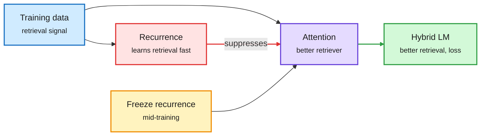

# Hybrid architectures: Competing Learning, KronLSTM, and the prompt's half-life

**Sources:** HuggingFace daily papers 2026-10-20: [Competing Learning in Hybrid Architectures, 2610.26830](https://arxiv.org/abs/2610.26830); [Kronecker Delta Rule for Long Context Linear Attention (KronLSTM), 2610.26834](https://arxiv.org/abs/2610.26834) ([code](https://github.com/NX-AI/KronLSTM)); [A Conditional No-Hair Theorem for Transformers, 2610.24133](https://arxiv.org/abs/2610.24133). Raw: `raw/huggingface/2026-10-20-*` matching slugs.

## TL;DR

- **Competing Learning**: in hybrids that mix linear-time recurrence with softmax attention, the two mixer types compete to learn the same function, and whichever learns it first suppresses the learning signal for the other. Under normal data, the recurrence learns retrieval faster, so attention usually never learns to retrieve, even though attention is the better retriever. **Freezing the recurrence weights mid-training lets attention learn retrieval.** A staged pre-training recipe improves loss, common-sense reasoning and retrieval across context lengths at up to 1B parameters.
- **KronLSTM**: a new linear-attention update, the Kronecker Delta Rule, revises a targeted association by changing memory along a single direction in matrix space. Less interference with old associations than the delta rule (DeltaNet family). Memory dynamics form a Markov chain with bounded expected norm, so no extra normalization is needed. Competitive with or better than Gated DeltaNet, strongest on long context. Open weights.
- **Conditional no-hair theorem**: the hidden-state difference caused by two different prompts decays roughly as a power law t^-α as generation continues. Trained models forget fast (α≈0.55-0.7), untrained slowly (0.2-0.5). Proven bound O(P (log t)^(L-1) / t). Any prompt property that survives long generation must be carried by the generated text itself.

The faster learner starves the better one

Recurrence grabs retrieval early; freezing it mid-training lets attention take over.

Red is the suppression, amber is the staged-training fix, green is the result.

## How this relates to prior wiki pages

- **Explains a recurring observation on [attention-mechanisms](attention-mechanisms.md):** hybrids keep only a few attention layers and those layers carry retrieval (Nemotron-3 Super hybrid MoE, 04-21; ReaDy on 10-20 reading hybrid recurrent states for drafting). Competing Learning says those few layers may be under-trained for retrieval by default. Serving implication: the KV cache of the few attention layers is the expensive part, and it may not be earning its cost.
- **KronLSTM is the stability answer** to the delta-rule family tracked on the same page.
- **No-hair theorem gives a theory reason** for KV eviction of far-past prompt tokens ([kv-cache](../inference-efficiency/kv-cache.md)): the prompt's direct influence decays as a power law, so its cache entries matter less over long generations. It does not license dropping instructions, since the text can relay them.

## Gaps

- Competing Learning tested to 1B; whether staged training matters at 30B+ hybrids is open.
- No-hair bound needs pre-norm activations bounded away from zero; how often that holds in practice is unclear.
