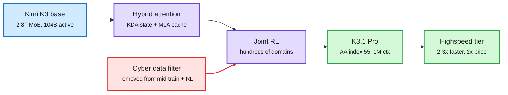

# Kimi K3.1 Pro

## TL;DR

Moonshot AI's Kimi K3.1 Pro is Kimi K3 (2.8T total, 104B active mixture-of-experts, 1M-token context, multimodal) with much more post-training compute: large joint RL across "hundreds of downstream domains." It scores 55 on the Artificial Analysis Intelligence Index, fourth overall, ahead of Fable 5.1, GPT-6 Astra and Gemini 4 Argon (53) and behind only Opus 5.5 (58) and two other models. On Terminal-Bench 4.0 it scores 65.7% against Opus 5.5's 66.4% and GPT-6 Astra's 58.2%. API price is $2 in / $10 out per million tokens, the same as GPT-6.1 Sol and half of Opus 5.5. A Highspeed variant runs 2-3x faster at twice the price, except cached input which costs the same. Weights are promised by November 4. If they ship, it is the first (soon) open-weight model this close to the frontier.

Same K3 body, much more RL

The architecture is unchanged; the gain is post-training compute plus the infra that makes it stable.

Blue is the inherited base, purple is the model and its RL, red is the safety filter, green is what shipped.

## Key claims

- **Post-training, not pretraining.** Moonshot says it rebuilt the RL framework, long-context inference, rollout scheduling, sandboxes and an environment-quality platform so each increment of RL compute "delivers stable, predictable returns." This is an RL-infrastructure release.
- **Benchmarks (vendor + third party):** AA Intelligence Index 55 (+11 over K3); Terminal-Bench 4.0 65.7%; Kimi Code Bench 3.0 long-horizon 61.2% (K3: 55.95%); OfficeQA Pro v2 64.4 vs Opus 5.5 62.2; Agents' Last Exam 43.2; HLE with tools 70.0. Weak spot: Terminal-Bench Science 38.1 vs GPT-6 Astra 68.1 and Opus 5.5 63.3.
- **Hallucination under tools:** false claims fall from 23.4% (K3) to 8.3%, between GPT-6 Astra (5.5%) and Opus 5.5 (15.0%), on Moonshot's internal test.
- **Cyber filtering:** exploit skill rose with post-training scale, so Moonshot removed cyber-related data from mid-training and RL. On internal xdev-bench-hard pass@3 fell from 90.5% to 81.0%, still far above K3's 33.3%. A third-party GPT-5.6 Sol run solved 100%.
- **Pricing:** $2 / $10 per M tokens; Highspeed 2-3x faster at 2x price with cached input at parity.

## Why the efficiency angle matters

K3's architecture (documented in the wiki's [kimi-k3-in-c summary](../inference-efficiency/2026-09-12-kimi-k3-in-c-nvme-expert-streaming.md)) mixes 69 KDA layers (Kimi Delta Attention, a linear-attention layer with a fixed-size recurrent state) with 24 MLA layers (multi-head latent attention, a compressed KV cache). That is why a 1M-token context is economically servable: most layers keep a constant-size state, and the remaining cache is latent-compressed. 104B active out of 2.8T total (about 3.7%) is what lets Moonshot price at half of Opus. The Highspeed tier pricing cached input at parity is a tell that its speedup comes from decode-side resources (more replicas or speculative decoding), not from cheaper prefill.

## Relation to prior wiki

- **Extends** the open-weight frontier race tracked since Muse Spark Open ([10-16](2026-10-16-muse-spark-open-and-nemotron-35.md)), where Meta opened a near-frontier model. K3.1 Pro narrows the open-to-closed gap on the AA index to three points.
- **Confirms** the "post-training compute is the lever" thread: like the 10-23 Harness Scaling paper (train RL across many harnesses for transfer), Moonshot credits breadth of RL domains, not model size.
- **Cyber filtering contrasts** with the containment approach in today's [containment summary](../responsible-ai/2026-10-24-containment-week-aisi-mythos-openai-offline-world.md): Moonshot removes the skill from data; Anthropic and OpenAI keep the skill and contain the model.

## Open questions

- Will the Nov 4 weights match the API model, and will independent reruns reproduce Terminal-Bench 4.0?
- Can a 2.8T checkpoint be served by anyone other than hyperscalers? The NVMe-streaming result for K3 says it runs on one CPU, but at seconds per token.
