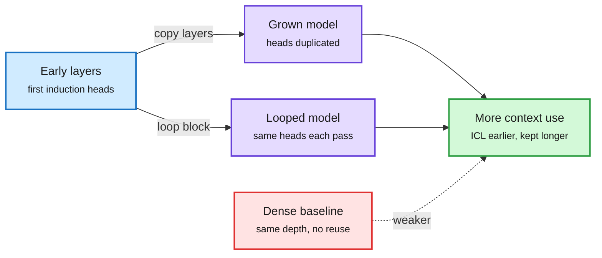

# Looped and depth-grown models learn more from context

**Source:** [How Depth Growth and Looping Shape In-Context Learning in Language Models (2610.31421)](https://arxiv.org/abs/2610.31421), Kapl (TU Munich, Helmholtz AI) with Maile, Bauer and von Oswald (Google Paradigms of Intelligence). DAIR pick ([page](https://academy.dair.ai/papers/how-depth-growth-and-looping-shape-in-context-learning-in-language-models-2610.31421)), amplified on X by [@omarsar0](https://x.com/omarsar0/status/2114404629064942018). Raw: `raw/twitter/feed/2026-10-26-morning-ranked.json`
**Topic:** looped transformers, parameter reuse, in-context learning

## TL;DR

Two ways to reuse computation across depth are popular for reasoning: *looping* a shared block several times, and *growing* depth during training by copying layers. This paper asks what reuse does to in-context learning (ICL: learning a task from examples in the prompt). At 3B parameters, both grown and looped models gain more from later context than a dense model of the same depth, score higher on GSM8K at every number of demonstrations, and predict unseen formal languages (RegBench) more accurately from the first string. In controlled Omniglot tasks they acquire ICL earlier, and when a task could also be solved by memorizing fixed labels in the weights, they keep relying on context. The mechanism is visible in attention heads: copying layers copies early induction heads (heads that find and copy earlier patterns), and most of the strongest final heads descend from a few early ancestors. Looped models repeat the same pattern across passes of the shared block.

Reusing layers reuses the induction heads

Copying or looping a block spreads early context-copying heads across depth.

Blue is the early layers, purple is the two reuse schemes, green is the stronger in-context learning, red is the dense baseline.

## Relation to prior wiki pages

- **Adds a capability axis to the [looped-transformers](looped-transformers.md) thread**, which so far has tracked compute: LEV (10-20/10-24, one looped checkpoint answers at any depth with a per-question stopper saving 15-24% compute) and looped diffusion LMs (10-23, 2.8-3.3x fewer training FLOPs). This paper says reuse also biases the model toward using context over memorizing.
- **Efficiency intersection:** a looped model with fewer unique parameters that leans on context is a natural fit for retrieval-heavy serving, where the weights are small and the knowledge is in the prompt. That also means KV cache, not weights, carries more of the work.
- **Gap:** tested to 3B only; no comparison at matched FLOPs (a looped model spends more compute per token than its parameter count suggests).

Related: [looped-transformers](looped-transformers.md) · [attention-mechanisms](attention-mechanisms.md)
