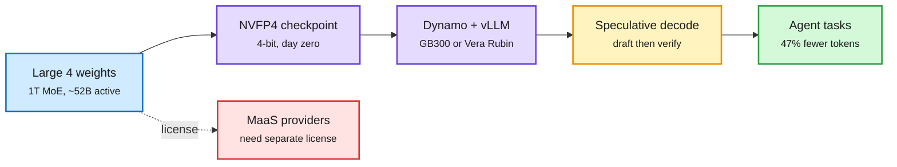

# Mistral Large 4 ("Le Chonk") open weights: a 1T MoE sold on tokens per task, shipped in NVFP4

**Sources:** [Mistral launch post](https://mistral.ai/news/mistral-large-4-oss/) · [NVFP4 checkpoint](https://huggingface.co/mistralai/Mistral-Large-4-1T-A52B-NVFP4) · [NVIDIA Dynamo recipe](https://docs.nvidia.com/dynamo/recipes/mistral-large-4) · [@rohanpaul_ai on license and price](https://x.com/rohanpaul_ai/status/2115876025452331018) · [The Decoder](https://the-decoder.com/paris-based-mistral-releases-le-chonk-a-strong-coding-model-that-still-trails-china-overall/) · [Hugging Face video](https://www.youtube.com/watch?v=FczbSauVvjw). raw: `raw/labs/2026-10-29-230224-labs.md`, `raw/rss/2026-10-29-the-decoder-paris-based-mistral-releases-le-chonk-a-strong-coding-m.md`, `raw/youtube/2026-10-30.json`.

**TL;DR.** Mistral released the weights of an improved Mistral Large 4, a 1T-parameter, natively multimodal MoE with about 52B active parameters, trained from scratch on 3,800 Grace Blackwell GPUs in Europe. Three more weeks of RL since the 10-07 preview lifted Terminal-Bench 4.0 from 28% to 41% (first among open models, 1 point above GLM-5.3) while cutting output tokens 30%. On the Artificial Analysis Coding Agent Index it ties GLM-5.3 at 48% while using 47% fewer tokens per task. It leads Cognition's private FrontierCode 2.0 at 19.7%, scores 51% on the AA Cyber Index and 93% of Cybench, and refuses 96.6% of malicious cyber prompts. API price roughly halved to $0.70 / $0.07 cached / $2.10 per million tokens. Three reasoning modes (low, medium, high default). The license changed: a modified-MIT "Mistral Ecosystem Open-Weight" license that requires model-as-a-service providers to get a separate commercial license, tighter than Large 3's Apache 2.0. Independent read from The Decoder: on the overall AA index it still trails China's best (26 vs 32 for DeepSeek V4.1 Flash and GLM-5.3).

A 1T open model is only open if it is servable

The 4-bit checkpoint and the serving recipe arrived the same day as the weights.

Blue is the release, purple is the serving stack, amber is speculation, green is the outcome, red is the license constraint.

## How it relates to prior wiki pages

- **Confirms** the token-efficiency-as-headline pattern: GPT-6.1 Terra (10-29) and Agent Arena's cost-per-task decomposition today both price capability per task, not per token. See [LLM routing](../ai-routing/2026-10-30-agentbaton-capable-to-cheap-handoff.md).
- **Extends** the open-cyber thread: Gemini 4 Carbon (10-29) went to defenders first; Mistral argues open weights *are* the defender channel. The same day Epoch AI reported open-weight GLM-5.3 built Firefox exploit chains for about $1,000 each ([responsible-AI summary](../responsible-ai/2026-10-30-frontier-monitoring-self-assessment-open-cyber.md)), which is the counter-case.
- **License drift.** A shift from Apache 2.0 to MaaS-restricted terms is a commercial response to hosts reselling open weights. Track whether others follow.

## Related

[Scaling laws](scaling-laws.md) · [Quantization](../inference-efficiency/quantization.md) · [Compute economics](../hardware/compute-economics.md)
