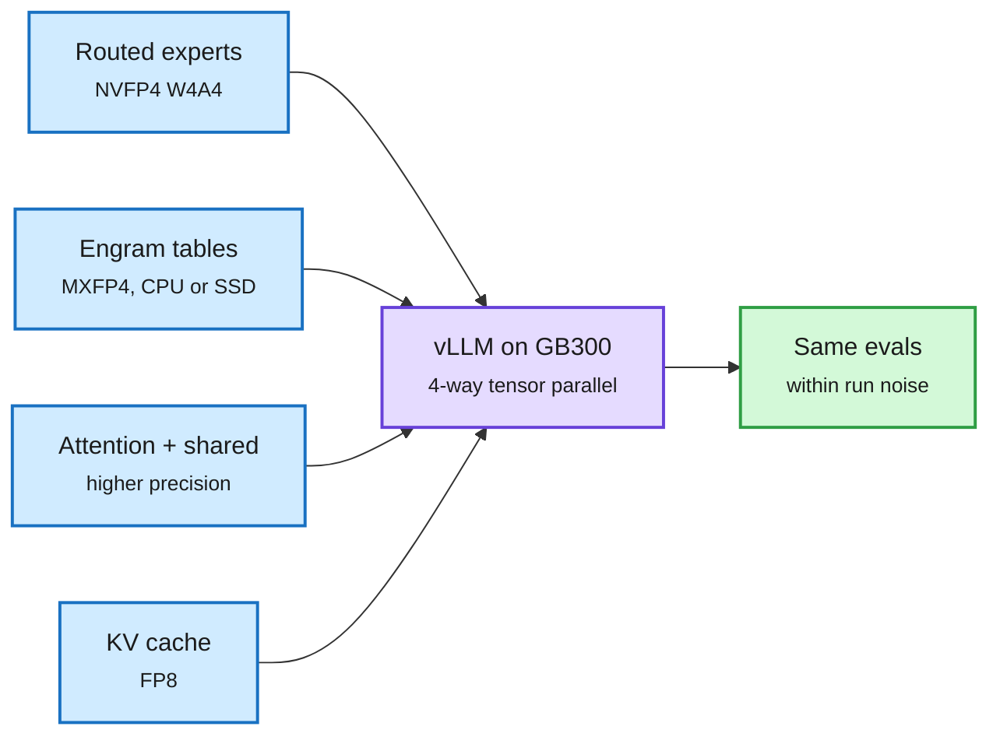

# Nemotron 3.5 technical report, and 4-bit everywhere (2026-10-31)

**Sources:** DAIR Academy pick + X (@dair_ai) · [arXiv 2610.38095](https://arxiv.org/abs/2610.38095) · [DAIR](https://academy.dair.ai/papers/nemotron-3-5-super-and-lightning-open-efficient-mixture-of-experts-hybrid-mamba-2610.38095) · NVIDIA HF model card [DeepSeek-V4.1-Flash-1017-NVFP4](https://huggingface.co/nvidia/DeepSeek-V4.1-Flash-1017-NVFP4) (`raw/labs/2026-10-31-133522-labs.md`) · Unsloth [DeepSeek-V4.1-Flash GGUF guide](https://unsloth.ai/docs/models/deepseek-v4.1-flash) (via X)

## TL;DR

Three artifacts in one window show the open-model stack converging on 4-bit serving with published accuracy checks.

1. **Nemotron 3.5 report (NVIDIA).** The full report for the hybrid Mamba-Transformer MoE family first seen on 10-16. Super: 120B total, 12B active, text+image+video. Lightning: 30B, 3B active, text. Super adds agentic software-engineering mid-training, Indic continued pretraining (+9.82 points on Indian-language benchmarks), SFT, RLVR and RLHF, then multi-teacher on-policy distillation (MOPD). Result: 51.78% SWE-bench Pro, above Nemotron 3 Ultra with ~4.6x fewer active parameters. Serving: up to 4,856 output tok/s/GPU on GB200 at ≥50 tok/s/user; post-training MTP boosting raises speculative acceptance length up to 21.8%; NVFP4 keeps 99.62% median accuracy vs BF16.
2. **NVIDIA's NVFP4 DeepSeek-V4.1-Flash-1017.** 552B backbone (8B active in prefill, 16B in decode) plus a 196B Engram conditional memory (n-gram lookup tables). Routed experts converted MXFP4 to NVFP4 (W4A4, group 16) losslessly for all 16.99B expert blocks; Engram tables FP8 to MXFP4 (lossy). Checkpoint ~400 GiB (from ~475). Runs on 4x GB300 in vLLM with FP8 KV cache and Engram CPU offload. Evals match source within noise: GPQA 92.93 vs 92.77, AA-LCR 80.19 vs 80.41, Terminal-Bench 2.1 81.11 vs 81.81. The card says plainly that lossless weight conversion does not by itself imply unchanged behavior, which is why it publishes evals.
3. **Unsloth Dynamic V3.1 GGUFs of the same model.** Claims top scores among its quants on GPQA, AIME25, LiveCodeBench; runs in 64GB+ RAM by mmap-offloading Engram tables to SSD (secondhand via X).

Where the bytes go in a 4-bit MoE server

Experts get the 4-bit format, memory tables get offloaded, attention stays higher precision.

Blue is each weight or cache class with its format, purple is the serving engine, green is the measured result.

## Gaps

Nemotron's SWE-bench Pro number is self-reported on NVIDIA's harness. The NVFP4 card did not exercise speculative decoding (MTP). Unsloth's "top on nearly all benchmarks" claim compares only against other quants and arrived secondhand.

## Relation to prior wiki

- **Confirms** the 10-30 thread that compression ships rather than publishes (Mistral Large 4 went out in NVFP4 on day zero). NVIDIA is now quantizing a competitor's flagship and publishing the eval table, the practice [Broken on Arrival](../inference-efficiency/2026-10-31-broken-on-arrival-quantized-artifacts.md) found registries lack.
- **Memory tiering** for Engram tables (SSD offload) continues the [conditional-memory-embeddings](../inference-efficiency/conditional-memory-embeddings.md) and 10-29 DeepInfer thread (disk-tier prefix cache cheaper than recompute).
- MTP boosting sits next to [Soft-MTP](../inference-efficiency/2026-10-31-soft-mtp-kl-gradient-recovery.md) (same goal, at pretraining time).
- Prior: [Muse Spark Open and Nemotron 3.5 (10-16)](2026-10-16-muse-spark-open-and-nemotron-35.md); concepts [quantization](../inference-efficiency/quantization.md), [knowledge-distillation](../inference-efficiency/knowledge-distillation.md).
