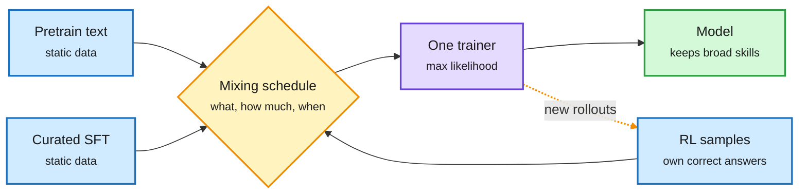

# Training recipes, re-derived: AIR's effective-LR schedule, one algorithm for every stage, and benchmarks as difficulty measures

**Date:** 2026-11-01 · **Sources:** HuggingFace Daily Papers 2026-10-30 (captured late, in the 11-01 window): [AIR / effective LR, arXiv 2610.40362](https://arxiv.org/abs/2610.40362); [Training Foundation Models with a Single Algorithm, arXiv 2610.40564](https://arxiv.org/abs/2610.40564) (CMU; cross-source via [@rohanpaul_ai](https://x.com/rohanpaul_ai/status/2116287151658901586)); [Your Benchmark Is an Empirical Measure Over Difficulty, arXiv 2610.29927](https://arxiv.org/abs/2610.29927) · **Raw:** [AIR](../../raw/huggingface/2026-10-30-your-lr-schedule-may-not-be-principled-effective-learning-ra.md), [Unified training](../../raw/huggingface/2026-10-30-training-foundation-models-with-a-single-algorithm.md), [Benchmark measure](../../raw/huggingface/2026-10-30-your-benchmark-is-an-empirical-measure-over-difficulty.md)

## TL;DR

Three papers that each take a training habit and show the habit was standing in for something more basic. **AIR** shows the recent pretraining gains credited to weight normalization (keeping weight norms fixed instead of using weight decay) come mostly from the *effective learning rate* it induces: the step size relative to the weight norm. Match the effective-LR trajectory and weight-normalized and weight-decay runs train almost identically. So the schedule should target effective LR. AIR (Affine Inverse-square-Root decay) is a 1/t-style decay with an affine fix to hit set peak and final LRs; on 128B-token MoE pretraining it beats cosine by about 0.01 terminal loss at matched cumulative LR and is more robust to hyperparameters, with most of the gain from the late stage of the schedule. **Unified training** (CMU) recasts RL objectives (via MaxRL) as maximum-likelihood fitting to the model's own correct answers, so pretraining, midtraining, SFT and RL become one likelihood trainer; the lifecycle becomes a data-mixing schedule. Blending beats staging: with a 0.76B model, mixing 5% midtraining data into math RL gave 32.69% on MBPP+ after later coding RL, vs 29.81% staged. **Benchmark-as-measure** treats a benchmark as a distribution over item difficulty and names two failure modes: *measure mismatch* (the benchmark overweights some difficulties) and *coverage gaps* (no items at some difficulties, so progress there is invisible). Across 25 benchmarks in 7 domains, many show one or both; BenchFill rewrites items to fill the gaps.

Staging is a special case of one data schedule

Once RL is likelihood on self-generated correct answers, every stage is just a choice of data and mix.

Blue is data, amber is the schedule (the only real design choice), purple is the single trainer, green is the result.

## Key points

- **AIR: tune the quantity that moves weights.** Nominal LR is the wrong knob once normalization or decay changes the weight norm. A shared late-stage effective-LR schedule also dampens the effect of earlier LR choices, which explains the robustness.
- **Unified training: hard stage switches erase skills.** Blended runs on 124M-scale reasoning puzzles beat the best staged run and kept general skills better.
- **Benchmarks: read leaderboards per difficulty band.** A benchmark that is mostly easy items saturates early and hides progress on hard ones.
- **Gaps.** AIR is shown at 128B tokens on one MoE family; the unified-training evidence is at 124M-0.76B; the benchmark difficulty estimates depend on the model pool used to estimate them.

## How it relates to prior wiki pages

- **Compute-efficiency angle.** These are training-cost papers in disguise: AIR buys loss at no extra compute, unified training removes wasted forgetting between stages. It fits the [scaling-laws](scaling-laws.md) page's thread that hyperparameter transfer (batch size, LR) is where cheap gains hide.
- **RL as likelihood.** [Soft-MTP (10-31)](../inference-efficiency/2026-10-31-soft-mtp-kl-gradient-recovery.md) found half of a standard multi-token loss was noise; unified training finds the RL/SFT split was a convention. Both are "the objective you were paying for was not the one doing the work." See [rl-for-llms](rl-for-llms.md).
- **Measurement thread.** Benchmark-as-measure joins [agent-benchmarks](../agentic-systems/agent-benchmarks.md) evidence that headline scores hide where models actually improve.
