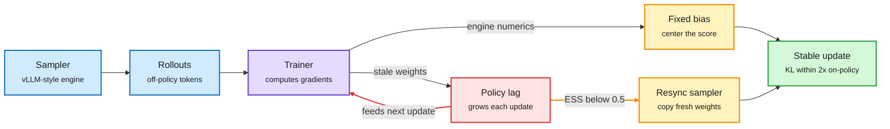

# On the Origin and Evolution of Training-Inference Mismatch in LLM RL (DLC)

**Source:** HuggingFace Daily Papers 2026-11-02 · [arXiv:2610.40945](https://arxiv.org/abs/2610.40945) · raw: `raw/huggingface/2026-11-02-on-the-origin-and-evolution-of-training-inference-mismatch-i.md`

## TL;DR

On-policy RL for LLMs samples with an inference engine and trains with a separate trainer, so the data is quietly off-policy. Evaluating the trainer at the sampler's weights splits each sampled-token error exactly into (a) the engine's numerical discrepancy, which stays roughly constant and can be removed by centering the score at each prefix, and (b) policy lag from stale async weights, which is produced by the trainer's own updates and feeds back into the next lag. Importance weighting breaks that loop only while the ratio stays concentrated; on Qwen3-1.7B it fails when the ratio's effective sample size drops below 0.5. The discrepancy-lag correction (DLC) centers the numerics, clips the lag ratio against the sampler's weights, and resyncs the sampler at ESS < 0.5, keeping KL from on-policy training within 2x the KL between two independent on-policy runs.

Numerics are a fixed tax; lag is a feedback loop

Evaluating the trainer at the sampler's weights separates the two error sources exactly.

Blue is the rollout path, purple is the trainer, red is the self-amplifying error, amber is a correction, green is the stable result.

## Key points

- Two mismatch sources need different fixes; a correction tuned for one can fail for the other.
- ESS < 0.5 is a cheap, observable resync trigger.
- A KL measured on sampler prefixes missed collapses that DLC's resync prevented.
- Scale tested: Qwen3-0.6B and 1.7B only.

## Relation to prior wiki pages

- Extends [RL for LLMs](rl-for-llms.md): after the 10-27 finding that accurate judges are not the best rewarders, this audits the other end of the pipeline, the rollout engine.
- Efficiency intersection with [quantization](../inference-efficiency/quantization.md): lower-precision rollout kernels add mostly the constant (removable) term, so cheaper rollouts are safer than feared if lag is controlled separately.
- Same week as DAIR's "No Free Lunch in RLVR" (2610.39295), which proves pass@1 gains carry a computable pass@k price.
