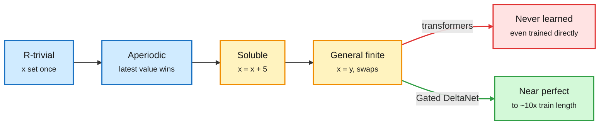

# StateBench (Ai2), DAMI, Library of Layers and BYOD: what recurrent memory can track

**Sources:** [Ai2 StateBench blog](https://allenai.org/blog/statebench) (lab watcher + HF blog) · [DAMI, arXiv 2610.41994](https://arxiv.org/abs/2610.41994) · [Library of Layers, arXiv 2611.03526](https://arxiv.org/abs/2611.03526) · [BYOD, arXiv 2610.41574](https://arxiv.org/abs/2610.41574) · raw: `raw/labs/2026-11-04-010839-labs.md`, `raw/huggingface/2026-11-03-*.md`

**TL;DR.** StateBench tests *state tracking*: following how entities change over a long document, such as variables in code or objects changing hands in a story. It has four levels taken from Krohn-Rhodes theory (a way to break state-tracking problems into basic algebraic building blocks). The levels are r-trivial (immutable assignment, `let x = 4`), aperiodic (reassignment, where the latest value wins), soluble (self-referential updates, `x = x + 5`) and general finite (assignment by reference and swaps, like the five-cup shell game, S₅). Frontier models (Gemini 3.8 Flash, Claude Opus 5.5, GPT-6 Sol and Luna) handle the first two levels. They drop to 13% or lower on the longest general-finite problems. Trained directly on the task, 275M Gated DeltaNet and hybrid models generalize almost perfectly on the first three levels out to tens of thousands of assignments, 250x their training length. The flexible-update Gated DeltaNet stays near perfect on the hardest level to about 10x training length. Transformers never learn the hardest level, even with direct training.

Four kinds of assignment, and where each architecture breaks

Transformers stall at reference assignment; recurrent memory gets through if it is trained for it.

Blue is easy levels, amber is the hard levels, green and red are the two architecture outcomes.

## Key points

- **The pretraining gap is in the data, not the architecture, for recurrent models.** Pretrained Olmo Hybrid sat at chance on general-finite problems. The same architecture family trained directly learned them. For transformers the limit is architectural.
- **Format matters.** A 275M hybrid scored near ceiling on RULER-style lookup but near chance on the *same* problem framed as spreadsheet edits. Single-format long-context benchmarks overstate what models can track.

## Same-day companions

- **DAMI (2610.41994).** In gated linear recurrences, how long memory lasts is set by decay parameters (A_log, dt_bias), and these barely move from their initial values during training. So initialization decides retrieval range. DAMI assigns geometric timescales across heads and a low-high-low input-sensitivity profile across layers, calibrated on a small activation sample, with no extra parameters. RULER-style retrieval rises 5.3-16.7 points across GDN, KDA, GDN2, Mamba-2 and RWKV-7, with language modeling roughly unchanged.
- **Library of Layers (2611.03526).** A global library of transformer blocks that a router *orders* at runtime, per input. One hyperparameter (library size) moves between parameter reuse (depth recurrence) and sparsity (MoE). It is competitive with dense, recurrent and MoE baselines on text. It uses different layer orders for different sudoku and maze strategies, and different orders by language and script. Intervening on the router forces a chosen strategy. It is routing over computation order, not only over experts.
- **BYOD (2610.41574).** A LoRA-only recipe that turns an autoregressive model into a diffusion LM (parallel, bidirectional generation). Adapters are 4.1-5.8% of parameters, the base stays frozen, and it needs at most 102.4M tokens and 3-4 hours on one Colab GPU. It works on Gemma 2 9B, Llama 3.1 8B, Qwen2.5 7B and Ministral 8B. BYOD-Gemma averages 50.6% vs LLaDA 8B's 51.9%. Open-generation quality at low step counts is the weak point (perplexity 8.3-11.1 vs 4.1).

## Relation to prior wiki

- **Explains** why hybrid releases keep adding linear-attention layers: Sebastian Raschka's "Open October" tally (10 open architectures in a month, several mixing Mamba-2, Kimi Delta Attention or MiniMax Sparse Attention with a few full-attention layers) lines up with this result. Attention still wins on recall; recurrence wins on state updates.
- **KV-cache angle.** Recurrent layers carry a fixed-size state instead of a growing KV cache. StateBench is evidence that this saving costs nothing on tracking tasks, and can even help, provided training covers them. See [KV cache](../inference-efficiency/kv-cache.md).
