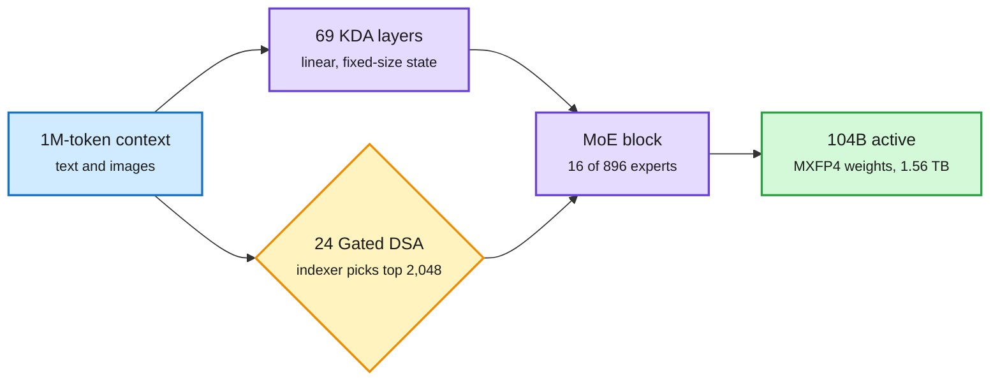

# Kimi K3.1 Pro: a 2.8T open-weight MoE that ships in 4-bit with sparse long-context attention

**Sources:** [Model card (Hugging Face)](https://huggingface.co/moonshotai/Kimi-K3.1-Pro) · [Moonshot tech blog](https://www.kimi.ai/blog/kimi-k3-1-pro) · lab watcher `raw/labs/2026-11-04-230204-labs.md` · [@Thom_Wolf breakdown](https://x.com/Thom_Wolf/status/2118026565879844910) · [Agent Arena](https://x.com/arena/status/2118088183594541527) · [@rohanpaul_ai](https://x.com/rohanpaul_ai/status/2118059884055024027) · Runpod and Ollama Cloud emails (Gmail)

**TL;DR.** Moonshot released the weights of Kimi K3.1 Pro, a post-trained successor to Kimi K3. It is a 2.8T-parameter mixture-of-experts (MoE: each token visits only a few specialist sub-networks) with 104B active per token: 896 experts, 16 routed plus 2 shared, 93 layers with one dense layer. Attention is 69 KDA (Kimi Delta Attention, a linear-attention layer with a fixed-size state) layers plus 24 Gated DSA (DeepSeek Sparse Attention: an indexer picks the top 2,048 past tokens for each query) layers. The change from K3 is replacing the full-attention Gated MLA layers with Gated DSA, so no layer attends to the full 1M-token context. Weights are MXFP4 with MXFP8 activations from quantization-aware training, so the release is ~1.56 TB rather than ~5.6 TB in BF16. On its own card it scores 65.7 on Terminal-Bench 4.0 (Opus 5.5: 66.4, GPT-6 Astra: 58.2) but 38.1 on Terminal-Bench-Science (Astra 68.1). Agent Arena ranks it #1 open and #13 overall across 17.5K+ real sessions, +4.2 points over K3. Moonshot says it traced rising exploit skill to cyber content in mid-training data and RL environments and removed both before release.

No layer reads the whole million tokens

Linear layers carry a fixed state; sparse layers read only 2,048 chosen tokens; weights live in 4-bit.

Blue is input, purple is the dense compute path, amber is the sparse selection step, green is the deployable result.

## Serving and pricing

- Runpod public endpoint: $2 / $10 per 1M input/output tokens; "Highspeed" variant 2-3x faster at $4 / $20.
- Ollama Cloud: US-hosted, zero data retention, one-line launch into Claude Code.
- Day-0 vLLM support reported at 800+ tok/s/user on VR200 for "the strongest open model yet" ([@mgoin_ via RedHat_AI](https://x.com/RedHat_AI/status/2118058736673505520)).

## How it relates to prior wiki pages

- **Confirms** Raschka's "Open October" count (11-04: 10 open architectures in a month, half using linear or sparse attention to shrink the KV cache). K3.1 Pro removes the last full-attention layers entirely.
- **Confirms** that quantization-aware training is the frontier default: DeepSeek-V4.1-Flash ran at 1-bit on a DGX Spark (11-04), Dory1.0-4B (today) pretrained 4.5T tokens in NVFP4.
- **Tension** with NVIDIA's "You don't need long context" (today): the architecture makes 1M context cheaper, the paper says agents rarely need it.
- **Expert count** keeps climbing (896, roughly 2x DeepSeek-V4-Pro and 7x Mistral Large 4), which raises the stakes on the MoE load-balancing results from today (Muon makes the first MoE layer harder to balance).

## Gaps

Benchmarks are self-reported, and coding evals used a Claude Code harness. The license is custom ("Kimi K3.1 Pro" license). The cyber-data removal is described but not quantified.

Related: [Attention mechanisms](attention-mechanisms.md) · [Quantization](../inference-efficiency/quantization.md) · [KV cache](../inference-efficiency/kv-cache.md)
