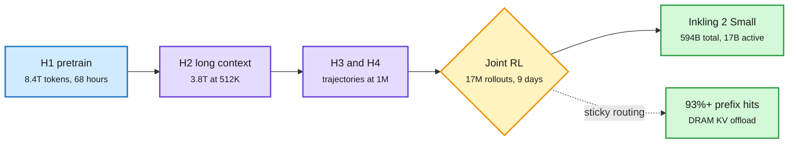

# Inkling 2 Small and the day's open MoE wave (ERNIE 5.5 Flash Base, Mochi, the MoE Handbook)

**Sources:** [Inkling 2 Small, Thinking Machines](https://thinkingmachines.ai/news/inkling-2-small/) · [@soumithchintala](https://x.com/soumithchintala/status/2118490925634556026) · [@eliebakouch](https://x.com/eliebakouch/status/2118512391331729860) · [ERNIE 5.5 Flash Base, The Decoder](https://the-decoder.com/baidu-releases-ernie-5-5-flash-base-with-280-billion-parameters-as-an-open-source-foundation-model/) · [Marin Mochi tracker](https://mumtracker.exe.xyz/hero-run-535b) · [The Ultimate MoE Training Handbook](https://huggingface.co/spaces/huggingface/moe-blogpost) · raw: `raw/twitter/feed/2026-11-06-morning-ranked.json` (private, gitignored)

**TL;DR.** Inkling 2 Small is a 594B-parameter MoE (mixture-of-experts, where each token visits a few specialist sub-networks) with 17B active. Its notable number is training cost. The first pretraining phase took 68 hours on GB300 racks, the whole pretrain used only about 12T tokens, and every stage ran natively in NVFP4 (4-bit floats). It reaches 31 on the Artificial Analysis index and would rank #1 among US open models on Code Arena WebDev. Weights are promised under Apache 2.0 next week, after external red-teaming.

A competitive open model from a few dozen days of training, all in 4-bit

One pretraining phase took 68 hours. Stretching context in stages replaced most of the usual token budget.

Blue and purple are pretraining stages, amber is the RL run, green is the output and the cache behavior that made it affordable.

## Inkling 2 Small details

- **RL run:** 1,075 steps, 17M+ rollouts, 9 days, 2,048 GPUs, over 4 x 10^23 FLOPs, 3T+ tokens. Rollouts: coding 38.5%, vision 13.9%, office work 9.1%. Median rollout 43K tokens, p99 1.5M. Training context 256K with compaction training for long-horizon tasks.
- **Coding:** FrontierCode v2.0 25.4% (DeepSeek-V4.1-Flash-1017 28.5%, Kimi K3 17.3%), DeepSWE v1.1 72.1%, SWEBench Pro v2 Hard 86.3%, Terminal Bench Science 5.7%.
- **Base-model comparison:** per @eliebakouch, its base model's perplexity loss on internal code is lower than Kimi K3.1's after "base-recovering" K3.1 for a fair test.
- **Customizability:** reaches the old Inkling Small's final performance in 75 training steps on a financial summarization task. In a demo it fine-tuned Qwen3.5-4B for forecasting for 4.5 hours and $426, more than doubling its score.
- **Safety:** internal misbehavior rate 14.9 (old Inkling 66.8, GPT-6.1 Sol 0.8). Thinking Machines says it still trails closed models on alignment evals.

## Other open-model items

- **ERNIE 5.5 Flash Base (Baidu):** 280B total, 14B active, 33.5T pretraining tokens, 128K training context with up to 1M designed for fine-tuning and inference. Shipped deliberately unpost-trained in FP8 and BF16. A post-trained version is promised.
- **Mochi 535B-A23B (Marin / Open Athena):** finished an 18T-token pretrain on 11-05, with long-context stretch this weekend and checkpoints hoped for next week. Its public tracker is an unusually open record of a frontier-scale run, including the gradient spike traced to one token whose expert choice was nearly tied, and the numerical error in attention gradients.
- **TwIL-8B (webAI):** 8.8B on IBM's Granite 4.2, 4.98 GiB quantized. Claims 81.6% on LiveCodeBench and 38% fewer tokens than Qwen3.5-9B on AIME 2026.
- **The Ultimate MoE Training Handbook (Hugging Face):** 800K GPU hours of experiments, about 70K words. Thom Wolf reports 18 of the 20 best open models are MoEs. Recommendations visible so far: keep the router in fp32 always, start aux loss near 1e-3, and note that loss-free bias gave MaxVio 0.04 versus 0.72 for aux loss 1e-3 at similar perplexity, while the bias update rate may be too coarse above 128 experts (at 1,024 experts the busiest reached about 50x the mean). This page covers only the Handbook's opening sections so far.

## How this relates to prior wiki pages

- **Compares with** [Kimi K3.1 Pro (11-05)](2026-11-05-kimi-k3-1-pro-open-weights.md): also trained for 4-bit, but 2.8T parameters. Together they make native low-precision training the default at both ends of the size range, not a post-hoc step.
- **Confirms** [scaling laws](scaling-laws.md): pretraining token count alone no longer predicts rank.
- **Extends** the load-balance finding in [the 11-05 MoE shorts](../inference-efficiency/2026-11-05-reasoning-compression-and-moe-shorts.md) (Muon roughly doubling imbalance in the first layer). The Handbook adds practitioner numbers on the same problem.
- **Links to** [Route Anything (11-05)](../ai-routing/2026-11-05-route-anything-omni-modal-routing.md): cheap customizable open models deepen routing pools.

## Gaps

All benchmarks are self-reported before weights are public. "A few dozen days" excludes failed runs and data work. Handbook numbers are from 8-GPU-node small test MoEs.
