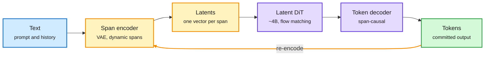

# Cola2: compress text into spans, generate the spans, then write the tokens

## TL;DR

ByteDance Seed released weights for **Cola2** ([arXiv 2610.31305](https://arxiv.org/abs/2610.31305)), a language model that does not generate one token at a time. It groups text into variable-length semantic spans, compresses each span into a compact continuous vector with a VAE, generates blocks of those vectors with a roughly 4B block-causal Diffusion Transformer (DiT) trained by flow matching, and then decodes each vector back into tokens with a span-causal token decoder. After each block, committed text is re-encoded so the continuous and discrete histories stay aligned. The released checkpoint saw 346B source tokens and reaches a 60.10 eight-task average. That trails Llama-3-8B (66.25), Qwen2.5-7B (75.08) and LLaDA-8B (72.11), but Cola2 used 43x fewer tokens than Llama-3 and beats it on HellaSwag and StoryCloze. Its latent DiT is still unconverged.

The DiT works on span vectors, not tokens

Compression happens before generation, so each generation step covers a whole span.

Blue is input, amber is compression and the feedback loop, purple is generation, green is output.

## Key claims

- **Two-stage training.** Stage I trains the span encoder and token decoder together. Stage II keeps adapting the VAE while the DiT learns the detached latent distribution.
- **Controlled scaling.** At matched size and data, uncompressed Cola-MDM scales best. Compressed Cola2-MDM converges more slowly but keeps closing on LLaDA after about 150B tokens and is unsaturated at about 210B.
- **Default inference.** 8-step Euler DiT schedule, DiT guidance 10, decoder guidance -0.9 (negative guidance stays near -0.9 for most of training). Generation is stochastic even with greedy token selection.
- **Release.** Base model only, inference code, eval data; no training code. Apache 2.0 code, weights under their own terms.

## Relation to prior wiki pages

- **Same paper, now with weights.** Cola2 first appeared as a short in [research shorts 10-24](2026-10-24-research-shorts-wait-iquest-dfm-mosaic.md).
- **Extends** [Aurora LM (08-05)](2026-08-05-aurora-lm-continuous-latent-diffusion.md), which generated text in continuous latent space at 1B scale. Cola2 adds learned span compression and a token-side decoder.
- **Contrasts** with [LLaDA MoE v2 (08-05)](2026-08-05-llada-moe-v2-scaling-moe-diffusion-lms.md): discrete masked diffusion still wins on aggregate benchmarks at this budget.
- The efficiency angle: if span compression holds, generation steps scale with spans, not tokens, which is a different lever from speculative decoding.

## Gaps

No serving numbers (tokens per second, memory) yet, which is what would make the compression matter in production. The comparison table mixes tokenizers and token-counting conventions, as the card itself notes.
