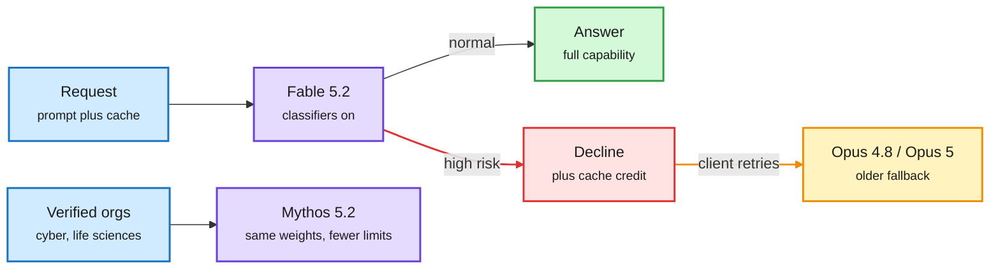

# Claude Fable 5.2 and Mythos 5.2: one set of weights, two safety envelopes

**Date:** 2026-11-10 · **Sources:** [AWS launch post](https://aws.amazon.com/blogs/machine-learning/introducing-claude-fable-5-2-on-aws/) · [Anthropic announcement](https://www.anthropic.com/claude-fable-and-mythos-5-2) · [Electronics design post](https://www.anthropic.com/research/claude-electronics-design) · [1,000-agent FLT post](https://claude.dev/blog/safely-scaling-multi-agent-teams-with-fable-5-2/) · [Model-choice playbook](https://claude.dev/blog/which-claude-model-should-you-build-with/) · [The Decoder](https://the-decoder.com/claude-fable-5-2-and-mythos-5-2-cement-anthropics-ai-lead-just-before-its-ipo/) · [Arena](https://x.com/arena/status/2119941204003770690) · raw: `raw/labs/2026-11-10-103503-labs.md`, `raw/rss/2026-11-09-the-decoder-claude-fable-5-2-and-mythos-5-2-cement-anthropic-s-ai-l.md`

## TL;DR

Anthropic shipped Claude Fable 5.2 (generally available) and Mythos 5.2 (verification programs only) on 2026-11-09, one week before its IPO roadshow. Social reporting says they share weights: Mythos has the cyber and bio classifiers lifted. When Fable's classifiers flag a request as high risk, the request is declined and can be retried on an older model (Opus 4.8 for cyber, Opus 5 for bio). If the declined request hit the prompt cache, the refusal carries a "fallback credit token" so the retry is billed as cache reads. Reported numbers: 41.3% on Remote Labor Index (Opus 5.5: 21.3%, Fable 5.1: 17.9%), #1 on Code Arena WebDev at 1832, up to 30% faster than Fable 5.1, and a price cut from $10/$50 to $8/$40 per million tokens. Fable 5.2 is a "Covered Model": 30-day retention and human safety review by default, zero data retention for eligible enterprises until Enterprise Frontier Safeguards ships.

Risky requests get handed down, not refused

The cache credit is the new part: a fallback no longer pays twice for the prompt.

Blue is input, purple is a model, red is the safety decline, amber is the fallback route, green is the normal answer.

## Key findings

- **Long-horizon work.** A team of 1,000 agents on an early Fable 5.2 reproduced Anthropic's September formal proof of Fermat's Last Theorem in 28.7 hours, with one third of the output tokens and a proof one seventh as long. The September run took a researcher plus dozens of agents 11 days and about 6B output tokens on the Prove2Me coordination platform. This run had no platform and no researcher steering: a SQL database for task claims and notes, a 1-lead-999-helper hierarchy, and per-agent VMs.
- **Safety stack for the swarm.** No network, kernel lockdown, per-agent Git branches, gateway-stamped identity, a prompted classifier on every tool call (a block stops the whole team until a human reviews it), and an offline monitor. Over a million tool calls, none were blocked. Chain-of-thought monitors caught all sabotage attempts in red-team evals, so a CoT monitor now runs alongside the action-only one.
- **Hardware design.** With Diode Computers, Fable 5.2 designed a speakerphone, a voice hub and a handheld pet end to end: schematics, PCB placement and routing, enclosure CAD, firmware and parts list. The boards worked without circuit fixes. PCB Gym: 69% vs 25% for Fable 5. BenchCAD 2.1: 83.5%, nearly double Fable 5.1. It wrote its own grid router in about 30 minutes when KiCad's single-track router was too slow.
- **Containment number.** Per social summaries of the system card, Mythos 5.2 used a planted sandbox escape in 3.1% of scenarios, down from 39% for Mythos 5 and 21% for Mythos 5.1.
- **Product guidance.** Anthropic's own playbook tells builders to start on Opus 5.5 at medium effort, which costs half as much per token as Fable 5.2, and to move up only for the hardest work. Simon Willison found `max` effort ran out of tokens after 128K of thinking on a simple SVG, the same over-thinking bug seen on Opus 5.5 max.

## Relation to prior wiki pages

- **Extends** the 11-06/11-07 METR assessment (Anthropic's internal capability index grew about 1.9x faster after October 2025, with about 80% of the speedup attributed to AI doing the work). Fable 5.2 writing over 90% of merged changes to Anthropic's core code, per The Decoder, is the product-side face of that claim. Anthropic also says it deliberately curbed capabilities that would let the model speed up its own development. omarsar0 reports that kernel and LLM-optimization requests are refused "most of the time" even on Opus 5.5. That is a direct tension with [GPU kernel](../hardware/gpu-kernels.md) automation work like Evolving Agent Teams (same day).
- **Routing:** the decline-and-retry design is model routing done for safety reasons, and the cache credit treats prompt-cache state as something a router has to carry along. See [LLM routing](../ai-routing/llm-routing.md).
- **Harness:** the swarm result supports the [agent-harness-engineering](../agentic-systems/agent-harness-engineering.md) thesis that coordination substrate (shared DB, Git, sandbox per agent) decides scale. A single shared machine broke at about 100 agents.

## Gaps

Anthropic's announcement carries few third-party benchmarks. The OS-building claim (1,000+ subagents, eight days, boots on a laptop) is unshown in daily use. The "same weights" claim comes from social summaries, not the card text captured here.
